<!-- ============================================================
     PORTADA — una sola por documento.
     cover-title: título principal · artist-name: nombre · url: enlace al sitio
     ============================================================ -->
::: {.cover style="background-image: url('./images/lamemoria4.png')"}

[Trabajo seleccionado]{.cover-subtitle}

# Portafolio {.cover-title}

::: {.cover-meta}
[Matías Serrano Acevedo]{.artist-name}

[https://misaa.cc](https://misaa.cc){.url}
:::
:::

<!-- ============================================================
     BIOGRAFÍA — una sola por documento.
     Admite hasta 3 párrafos dentro de .bio-body.
     ============================================================ -->
::: {.bio}
## Biografía

::: {.bio-body}
Matías Serrano Acevedo (Santiago, 1993) es artista sonoro y electrónico. Magíster en Artes Mediales (2024) y Licenciado en Artes mención Sonido (2017), ambos de la Universidad de Chile. Becario desde 2026 del programa de Doctorado en Artes y Humanidades de la Universidad de Santiago de Chile. 

Académico adjunto y parte del Núcleo de Artes Sonoras del Departamento de Artes Visuales de la U. de Chile. Ha presentado su trabajo en diversos espacios, exposiciones y festivales en Chile y latinoamérica y ha publicado varios álbumes bajo el pseudónimo de “misaa”. Desde 2022 se desempeña como docente de arte, electrónica y medios en carreras de artes visuales en UNIACC, UDP y U. de Chile. Creó la Colectiva 22bits en 2015 y el sello Archivo Veintidós en 2019 junto a Bárbara Molina, a través de los cuales participaron de encuentros y festivales de arte, tecnología, sonido y diseño en Chile, México, Argentina y Colombia.
:::

:::

<!-- ============================================================
     STATEMENT — una sola por documento.
     Para omitir la imagen vertical, elimina el bloque .statement-image.
     statement-body admite varios párrafos.
     ============================================================ -->
::: {.statement}
::: {.statement-left}
## 

::: {.statement-image}

:::
:::

::: {.statement-body}
Las artes sonoras se producen desde materiales, fenómenos y discursos // Las artes sonoras, a su vez, crean materiales, fenómenos y discursos // Lo sonoro tiene que ver con estos tres elementos articulados en la escucha // Las articulaciones producen el espacio-tiempo // Naturaleza, cultura y materia están co-implicados y no pueden entenderse de otra manera que desde su enredamiento // Así, vamos encontrando co-implicaciones, ocasiones actuales: equilibrios precarios, fenómenos de la atmósfera, manifestaciones de gargantas humanas, campos electromagnéticos generados por chips de silicio // Estos y otros flujos intensivos de la naturaleza emergen catastrófica y creativamente desde un fondo energético ruidoso, los cuales —ocasionalmente— conforman lo sonoro.

[“Estamos inmersos en [el ruido] hasta el cuello, hasta los ojos y hasta la coronilla, en un océano furioso, iracundo; mejor aún, somos de parte a parte la voz de este huracán, ese bramido térmico, y no sabemos nada de ello.” — Michel Serres]{.statement-quote}
:::
:::

<!-- ============================================================
     PROYECTO — copiar este bloque completo para cada obra.
     Usa {.project} para imagen a la izquierda (por defecto)
     Usa {.project .project-right} para imagen a la derecha
     · project-number: número de fondo (01, 02…)
     · h2: título de la obra
     · project-subtitle: Instalación / Concierto / Residencia / …
     · project-materials: circuitos, parlantes, micrófonos, pintura… (opcional)
     · párrafo de descripción
     · enlace: "[Técnica / Año — Ver proyecto →](url)"
     Alt de la imagen: aparece como crédito fotográfico superpuesto.
     ============================================================ -->
::: {.project}
::: {.project-image}

:::

::: {.project-text}
[DOCK Kunstraum, Archiv und Ausleihe. Basilea, Suiza]{.project-location}

## Territórios Reimaginados: Reclaim Regional (2026)

[RESIDENCIA Y EXPOSICIÓN A DÚO + CIEL BAUMGARTNER VIZKELETY]{.project-subtitle}
[Ensamblajes cinéticos y sonoros con objetos cotidianos recolectados en Basilea, dibujos y kit de poesía magnética. Colaboración entre DOCK y MAVI UC]{.project-materials}

Entre agosto y septiembre de 2026, a través de una convocatoria de MAVI UC, realicé una residencia en DOCK Basel junto a la artista suiza Ciel Baumgartner Vizkelety. Durante un mes usamos el espacio como taller y plataforma de intercambio para un proceso de investigación compartido sobre pertenencia, visibilidad y diversidad cultural, que cuestiona las estructuras coloniales presentes en las residencias artísticas y en los procesos migratorios.

Los resultados se presentaron en una exposición a dúo durante Kunsttage Basel, acompañada de una mesa redonda y un artist talk.

[Documentación completa y video](https://misaa.cc/projects/territoriosreimaginados.html)
:::
:::

<!-- INICIO PROYECTO -->

::: {.project .project-right}
::: {.project-image}

:::

::: {.project-text}
[Piscina Campo Deportivo Juan Gómez Millas, U. de Chile. Santiago, Chile]{.project-location}

## Aproximaciones subacuáticas (2025–2026)

[INVESTIGACIÓN Y CONCIERTO + CLUB SONORO DEPORTIVO]{.project-subtitle}
[Con Fernanda Fábrega y Santiago Corvalán. Entrenadora: Gissela Cabrera. Performers: Amparo Saona, Deysi Cruz, Inti Vega, Jenniffer Verdugo, Sergio Menares y Sofía Hurtado. Fondart Nacional 2025]{.project-materials}

Proyecto de investigación que explora la relación entre la natación, la escucha y la creación sonora. En sesiones mensuales, un grupo de nadadorxs no profesionales entrenó técnica y resistencia junto con escucha profunda y orientación a través del sonido: otras maneras de cruzar la piscina, escuchar a través de la piel, registrar con hidrófonos y crear cartografías sonoras, partituras y onomatopeyas.

El proceso culminó en _Nada como una metáfora_ (28 de marzo de 2026), concierto sonoro-performativo en el que lxs nadadorxs se vuelven intérpretes, la entrenadora directora de orquesta y la piscina un instrumento. Su registro fue publicado como álbum en vivo por Archivo Veintidós.

[Documentación completa y video](https://misaa.cc/projects/aproximaciones-subacuaticas.html)
:::
:::

<!-- FIN PROYECTO -->

<!-- ============================================================
     PROYECTO — copiar este bloque completo para cada obra.
     Usa {.project} para imagen a la izquierda (por defecto)
     Usa {.project .project-right} para imagen a la derecha
     · project-number: número de fondo (01, 02…)
     · h2: título de la obra
     · project-subtitle: Instalación / Concierto / Residencia / …
     · project-materials: circuitos, parlantes, micrófonos, pintura… (opcional)
     · párrafo de descripción
     · enlace: "[Técnica / Año — Ver proyecto →](url)"
     Alt de la imagen: aparece como crédito fotográfico superpuesto.
     ============================================================ -->
::: {.project}
::: {.project-image}

:::

::: {.project-text}
[Galería Metropolitana. Santiago, Chile]{.project-location}

## Llluvia Metropolitana (2026)

[Instalación + Rainer Krause]{.project-subtitle}
[Andamio intervenido, 5 parlantes, archivo de audio de 5 canales, 4 dibujos de acuarela y tinta china sobre papel, 3 circuitos electrónicos generadores de ruido de lluvia]{.project-materials}

"_Llluvia Metropolitana_ emerge alrededor de una premisa sonora que intenciona la experiencia sensible con el clima. Los artistas instalaron un sistema de grabación en los techos de zinc de la galería durante el período de lluvias invernales. Parte de este registro se nos presenta desde una altura a la que podemos acceder cuando subimos por un andamio reforzado. Se propone entonces un encuentro entre una lluvia anterior, o quizás una lluvia en pausa, que frente a la sensación atmosférica calurosa y seca, propia de enero en la ciudad, propone a lo menos una disonancia." — Extracto de texto por Catalina Montero

[Documentación completa y video](https://misaa.cc/projects/llluviametropolitana.html)
:::
:::

::: {.project}
::: {.project-image}

:::

::: {.project-text}
[Galería Metropolitana. Santiago, Chile]{.project-location}

## Llluvia Metropolitana (2026)

[Instalación + Rainer Krause]{.project-subtitle}
<!-- [Circuitos electrónicos, micrófonos, parlantes, madera, andamio]{.project-materials} -->

El proyecto expositivo consiste en una sola gran obra ensamblada a partir de elementos co-construidos entre Rainer y Matías, y de ejercicios realizados de manera independiente. El eje de la muestra es el sonido de la lluvia, que fue grabada por medio de un sistema de 4 micrófonos instalados cerca del techo de zinc del espacio durante los meses de junio, julio y agosto de 2025, que registraban en un computador controlado de manera remota el sonido de cada evento de lluvia. En total, se registraron alrededor de 164 GB de audio, lo que equivale a unas 126 horas de audio a 4 canales, aproximadamente. Estos fueron editados y mezclado en una banda sonora de 4 horas, que se reproduce en la sala durante el horario de apertura de la galería. 

[Documentación completa y video](https://misaa.cc/projects/llluviametropolitana.html)
:::
:::

<!-- INICIO PROYECTO DERECHO -->
<!-- INICIO PROYECTO DERECHO -->
<!-- INICIO PROYECTO DERECHO -->

::: {.project .project-right }
::: {.project-image}

:::

::: {.project-text}
[Galería Artes Visuales UNIACC. Santiago, Chile]{.project-location}

## Cuando todas las palabras sean borradas (2025)

[EXPOSICIÓN A DÚO + ALMENDRA DÍAZ]{.project-subtitle}
[
     _oí 1_. Instalación Ladrillo de concreto, piola de acero, motor paso a paso unipolar, piedra de canto rodado, microcontrolador atmega328p 
]{.project-materials}

[
     _oí 2_. Instalación. Monitor Sony PVM-8020, eslinga de amarre, Raspberry Pi 4, audio en estéreo e imagen generativa en p5.js, audífonos 
]{.project-materials}

[
     _oí 3_. Ensamblaje. Frasco de vidrio, bolitas transparentes, pieza de tercera mano, motor de microondas, cordón eléctrico, gancho de acero 
]{.project-materials}

"El adjetivo no implica carencia de valor, sino una voluntad de situarse fuera del régimen del significado: objetos que no devienen signo, que no aspiran a construir sentido. Se trata de una propuesta material que explora la contingencia de los materiales, en tanto estados puntuales de una materia afectada por fuerzas externas. Son, quizás, el sustrato actual para metáforas futuras. Objetos sin función, sin intención comunicativa, sin correlación con un sujeto: fragmentos de materia que solo dan cuenta de los flujos energéticos que los han atravesado, y que no buscan ser leídos, sino simplemente estar." — Extracto de texto curatorial

[Documentación completa](https://misaa.cc/projects/cuandotodaslaspalabras.html)
:::
:::

<!-- FIN PROYECTO DERECHO -->
<!-- FIN PROYECTO DERECHO -->
<!-- FIN PROYECTO DERECHO -->

<!-- ============================================================
     PÁGINA IMAGEN COMPLETA 
     ============================================================ -->
::: {.fullpage}

:::

<!-- FIN IMAGEN COMPLETA -->

<!-- INICIO PROYECTO DERECHO -->
<!-- INICIO PROYECTO DERECHO -->
<!-- INICIO PROYECTO DERECHO -->

::: {.project .project-right .caption-dark}
::: {.project-image}

:::

::: {.project-text}
[Museo MAC Quinta Normal. Santiago, Chile]{.project-location}

## Transistores en tránsito (2025)

[INSTALACIÓN]{.project-subtitle}
[10 placas electrónicas con circuito de compuertas NAND y driver, 10 bobinas de baja impedancia, 10 imanes, alambre esmaltado. 120 x 270 cm
]{.project-materials}

Parte de la exposición “Tiempo de Decaimiento Temprano” del Núcleo de Artes Sonoras en Museo MAC de Quinta Normal.

"El concepto de “nube” en la tecnología electrónica opera como una metáfora que propone un desacoplamiento de los dispositivos con la tierra. Sin embargo, ese lenguaje parece olvidar que toda tecnología tiene un origen en el suelo. El silicio, materia prima de los transistores y procesadores, es el segundo material más abundante en la tierra. El cobre conduce y conecta la geopolítica global, como sugiere Ingrid Wildi. El plástico proviene de milenarios combustibles fósiles. Según Jussi Parikka, estos elementos en su uso se degradan a sí mismos, retornando a su condición de “polvo”. En el trayecto, por medio de diversas energías, se mueven, transforman y relacionan." — Extracto cédula

[Documentación completa y video](https://misaa.cc/projects/transistoresentransito.html)
:::
:::

<!-- FIN PROYECTO DERECHO -->
<!-- FIN PROYECTO DERECHO -->
<!-- FIN PROYECTO DERECHO -->

<!-- INICIO PROYECTO -->
<!-- INICIO PROYECTO -->
<!-- INICIO PROYECTO -->

::: {.project}
::: {.project-image .caption-dark}

:::

::: {.project-text}
[Museo MAC Quinta Normal. Santiago, Chile]{.project-location}

## Un trazo en el oído (2025)

[INSTALACIÓN]{.project-subtitle}
[3 piolas de acero, 3 bobinas de alta impedancia, 3 bobinas de baja impedancia, 6 imanes de neodimio, tensores, 3 amplificadores de audio, 3 placas electrónicas con circuito astable 700 x 350 x 50 cm]{.project-materials}

Parte de la exposición “Tiempo de Decaimiento Temprano” del Núcleo de Artes Sonoras en Museo MAC de Quinta Normal.

"La obra plantea que el acto de trazar/tejer comienza en la extrañeza que representan los fenómenos acústicos, a los que accedemos desde antes de nacer. Por medio de materiales industriales se activa electromagnéticamente una pared para que resuene y amplifique su plasticidad inherente." — Extracto cédula  

[Documentación completa y video](https://misaa.cc/projects/untrazoeneloido.html)
:::
:::

<!-- FIN PROYECTO -->
<!-- FIN PROYECTO -->
<!-- FIN PROYECTO -->

<!-- ============================================================
     PÁGINA IMAGEN COMPLETA — copiar este bloque para cada imagen a pantalla completa.
     El texto del alt ![...] aparece como crédito fotográfico
     superpuesto en la esquina inferior derecha.
     ============================================================ -->
::: {.fullpage}

:::

<!-- ANID 2027 · NUEVO · Hablar con extraños -->
::: {.project .project-right}
::: {.project-image}
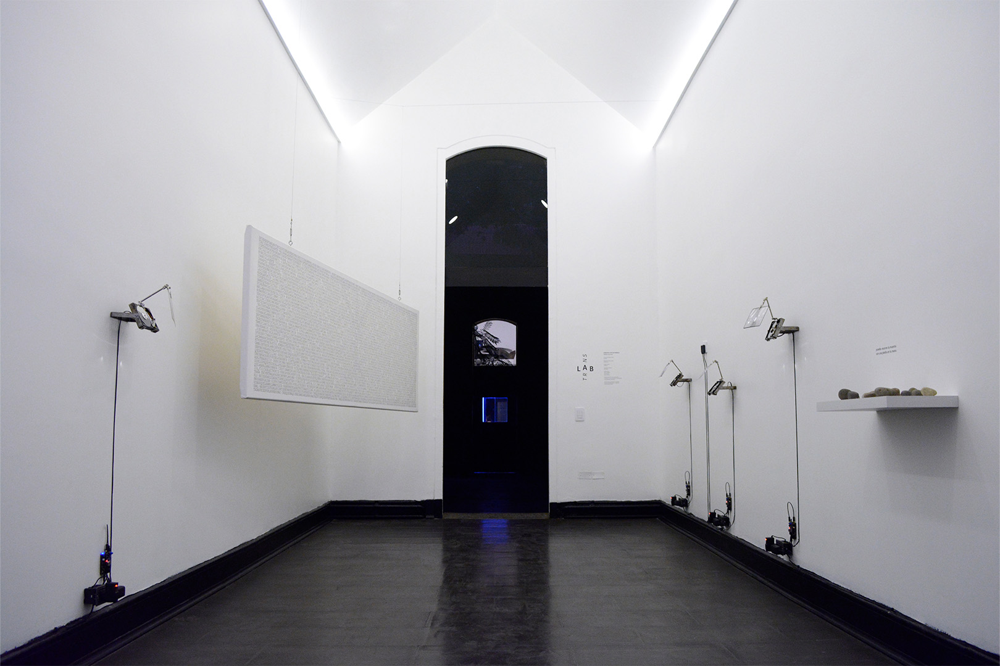
:::

::: {.project-text}
[Galería Micromedios, FAU U. de Chile. Santiago, Chile]{.project-location}

## Hablar con extraños (2025)

[INTERVENCIÓN MEDIAL]{.project-subtitle}
[Ensamblajes con discos duros, lupas y atriles, texto impreso, piedras de canto rodado. Curatoría por Vicente Domínguez (DIC FAU). Adaptación de _Amplificar la duda_ (2024)]{.project-materials}

"La intervención medial, “Hablar con extraños”, presenta, a través de recursos sonoros y textuales, fragmentos de una serie de diálogos que el artista sostuvo y documentó, entre 2021 y 2023, donde sus interlocutores/as reflexionaron sobre la experiencia de sentirse extraños en diversos contextos de percepción, socialización y habitar. (…) De este modo, sonido, archivo y máquina entran aquí en tensión." — Extracto de texto curatorial

[Información de la exposición](https://translab.uchilefau.cl/hablar-con-extranos/)
:::
:::

::: {.fullpage .caption-dark}
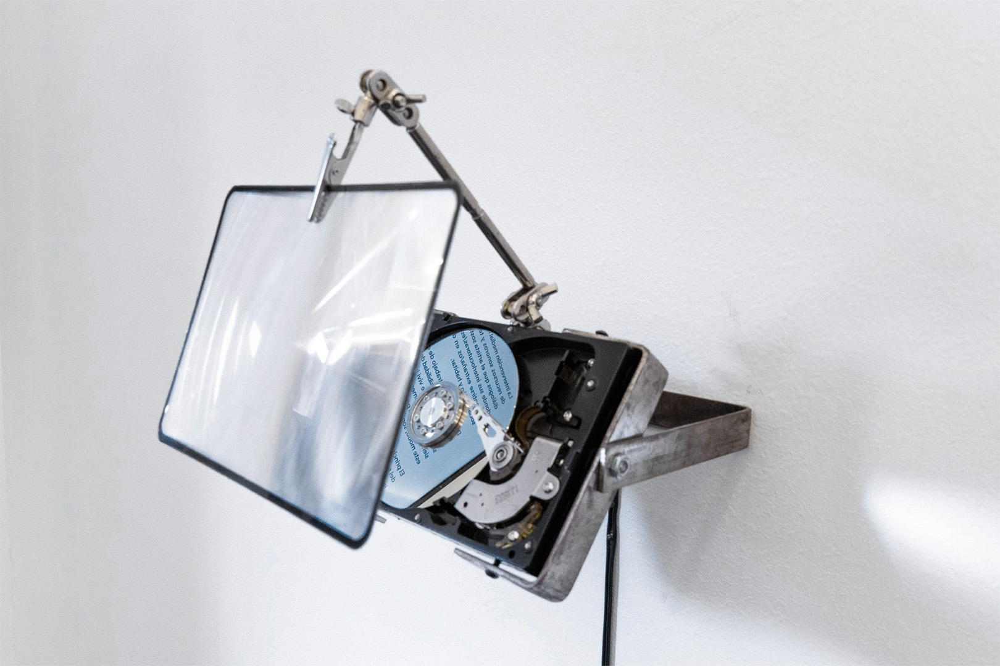
:::

<!-- FIN IMAGEN COMPLETA -->

<!-- INICIO PROYECTO -->
<!-- INICIO PROYECTO -->
<!-- INICIO PROYECTO -->

::: {.project}
::: {.project-image}

:::

::: {.project-text}
[Museo MAC Quinta Normal. Santiago, Chile]{.project-location}

## Lenguaje y comunicación (2024)

[INSTALACIÓN]{.project-subtitle}
[3 sillas de plástico negras, 3 audífonos, 3 reproductores de audio, ladrillo de concreto, piedras de río, archivo de audio en mp3 de 28 minutos dividido en 3 partes. Parte de la exposición colectiva Balmaceda Visual: Bordes Fluidos en Museo de Arte Contemporáneo de Quinta Normal. 2024. ]{.project-materials}

 La obra propone una lectura en torno a la comunicación y los gestos que la constituyen. Mediante la amplificación de los espacios negativos de una conversación, como los titubeos, silencios, muletillas y respiraciones, se busca retorcer los conceptos de emisor, receptor y mensaje. La obra sitúa a quien experiencia la obra en medio de un extenso diálogo que parece no llevar a ninguna parte, en el que la conversación de dos personas es editada de forma en que se deja oír solo el ruido entre palabras. La experiencia de la obra se completa al sentarse en una de las tres sillas, alrededor de un ladrillo de concreto que contiene piedras ovaladas, generando una puesta en escena -paradójicamente- tan extraña como habitual. 
 
[Documentación completa](https://misaa.cc/projects/lenguajeycomunicacion.html)
:::
:::

<!-- FIN PROYECTO -->
<!-- FIN PROYECTO -->
<!-- FIN PROYECTO -->

<!-- INICIO PROYECTO -->
<!-- INICIO PROYECTO -->
<!-- INICIO PROYECTO -->

::: {.project}
::: {.project-image}

:::

::: {.project-text}
[Sala Juan Egenau. Santiago, Chile]{.project-location}

## Amplificar la duda (2024)

[PROYECTO EXPOSITIVO]{.project-subtitle}
[7 ensamblajes basados en reproductores de audio, discos duros, atriles de micrófono y lupas. Piedras de canto rodado e impresión en canvas.]{.project-materials}

 "Inspirado" por el trabajo audiovisual de Amel Baggs en In my language (2007) y de los dibujos de los movimientos cotidianos de niños autistas realizados por Fernand Deligny, me propuse retroceder a los gestos y rasgos que los diagnósticos psiquiátricos ligados al espectro autista buscan envolver, sugiriendo el concepto de “sensibilidad extraña”. Desde esta idea, generé instancias de escucha donde dialogué con personas adultas que, independiente de si contaban o no con un diagnóstico, me comentaron sus historias, dudas, rasgos y comportamientos que podrían ser calificados como extraños. A través de la exposición, reflexiono en torno a las percepciones, rasgos y gestos extraños, especulando sobre los límites y categorías de lo que significa ser una persona." — Extracto de texto muro 
 
[Documentación completa y video](https://misaa.cc/projects/amplificarladuda.html)
:::
:::

<!-- FIN PROYECTO -->
<!-- FIN PROYECTO -->
<!-- FIN PROYECTO -->

<!-- ============================================================
     PÁGINA IMAGEN COMPLETA — copiar este bloque para cada imagen a pantalla completa.
     El texto del alt ![...] aparece como crédito fotográfico
     superpuesto en la esquina inferior derecha.
     ============================================================ -->
::: {.fullpage .caption-dark}

:::

<!-- FIN IMAGEN COMPLETA -->

<!-- INICIO PROYECTO DERECHO -->
<!-- INICIO PROYECTO DERECHO -->
<!-- INICIO PROYECTO DERECHO -->

::: {.project .project-right .caption-dark}
::: {.project-image}

:::

::: {.project-text}
[Museo MAC Quinta Normal. Santiago, Chile]{.project-location}

## Museo en estéreo (2024)

[INSTALACIÓN SONORA]{.project-subtitle}
[Desarrollada en laboratorio de Sonido y Objeto en conjunto con la Unidad de Educación del Museo de Arte Contemporáneo, María Ignacia Valdebenito y vecinxs y transeúntes de las dos sedes del Museo de Arte Contemporáneo 
]{.project-materials}

"Se trata entonces de una inmersión en la geografía que se traduce en archivos sonoros y que, tras una nueva vuelta de tuerca, deviene en la serie de piezas que conforman Museo en estéreo. De manera más visible, la muestra se compone de un patio de objetos colgados. Pero junto a ellos también hay diagramas con los enunciados de las instrucciones de la caminata, un video donde se pueden observar los puntos de georeferenciación de los participantes (quienes activaron sus gps durante el recorrido), una pared con las fichas que intercambiaron y un diagrama que muestra el sistema utilizado para reproducir los archivos recolectados durante el taller." — Extracto de hoja MAC 

[Documentación completa](https://misaa.cc/projects/museoenestereo.html)
:::
:::

<!-- FIN PROYECTO DERECHO -->
<!-- FIN PROYECTO DERECHO -->
<!-- FIN PROYECTO DERECHO -->

<!-- ANID 2027 · NUEVO · Campos eléctricos afiebrados -->
::: {.project}
::: {.project-image}
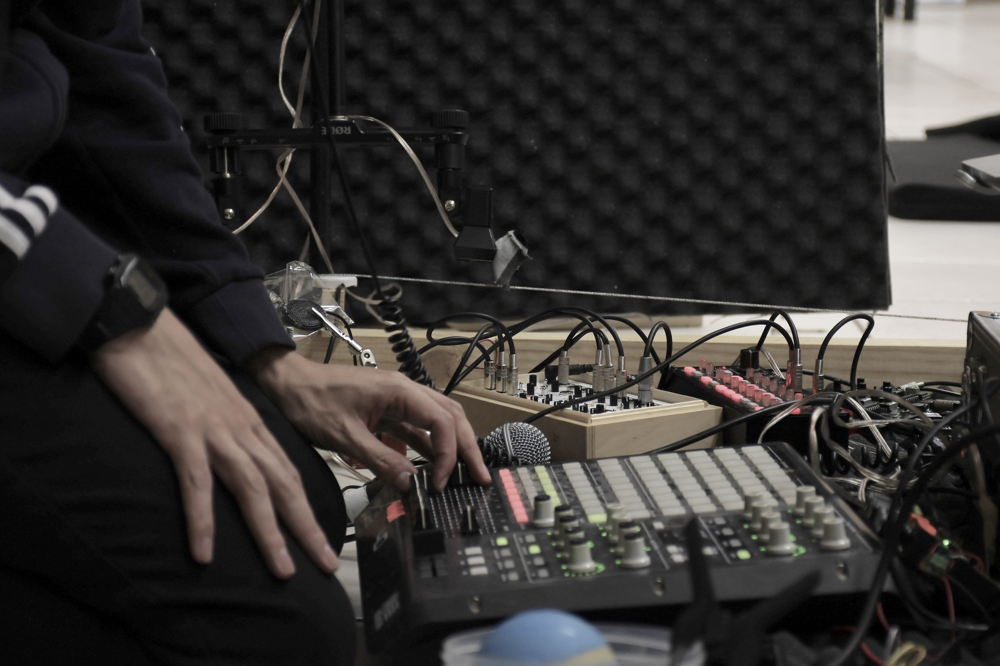
:::

::: {.project-text}
[Anilla Cultural MAC. Santiago, Chile]{.project-location}

## Campos eléctricos afiebrados (2024)

[PIEZA SONORA PARA PODCAST]{.project-subtitle}
[Motores, vibradores, ventiladores, señales FM, transistores, micrófonos caseros, secuenciadores y procesamiento digital. Podcast sesiones·para·espectrales, capítulo «Transducción»]{.project-materials}

Pieza creada especialmente para el podcast _sesiones·para·espectrales_ de Anilla MAC, orientado a las prácticas sonoras en el arte local. El capítulo desarrolló el concepto de transducción, y en él presenté esta obra junto a una conversación sobre prácticas sonoras en las artes visuales.

El título reorganiza una frase de Graham Harman: “(…) debemos mantener un sano escepticismo frente a cualquier propuesta afiebrada en el sentido de que todo grano de arena o campo eléctrico es, en realidad, un poeta: tal vez no lo es”. Tampoco creo que lo que hagan los electrones sea poesía, pero es bonito dialogar con ellos y escuchar los movimientos extraños que tienen.

[Registro en YouTube](https://www.youtube.com/watch?v=lgXexOipaPY)
:::
:::

<!-- INICIO PROYECTO -->
<!-- INICIO PROYECTO -->
<!-- INICIO PROYECTO -->

::: {.project}
::: {.project-image}

:::

::: {.project-text}
[Museo de Artes Visuales. Santiago, Chile]{.project-location}

## La memoria contándole a la luz el sonido de la lluvia (2023)

[INSTALACIÓN]{.project-subtitle}
[2 discos duros modificados, ampolleta incandescente, reproductor y amplificador de audio estéreo. Obra ganadora premio del público XVI Premio MAVI UC]{.project-materials}

"Dos discos duros son modificados para cumplir otra función. Ya no almacenan memorias, sino que según la vibración de su aguja se convierten en parlantes. El sonido que genera cada pieza es el registro de una de las últimas lluvias del 2021 en Santiago. En poca fidelidad, ambos discos duros intentan reconstruir el relato sonoro de lo que fue esa lluvia. No es posible que un aparato que no fue diseñado para reproducir sonido genere una buena experiencia sonora de la lluvia, y tampoco es posible que un aparato de registro/reproducción cualquiera se acerque mínimamente a la experiencia de la percepción. Es una lluvia torpe, que no deja charcos." — Extracto de texto de obra 
 
[Documentación completa y video](https://misaa.cc/projects/lamemoria.html)
:::
:::

<!-- FIN PROYECTO -->
<!-- FIN PROYECTO -->
<!-- FIN PROYECTO -->

<!-- ANID 2027 · NUEVO · Utopías y distopías de la modernidad -->
::: {.project .project-right}
::: {.project-image}
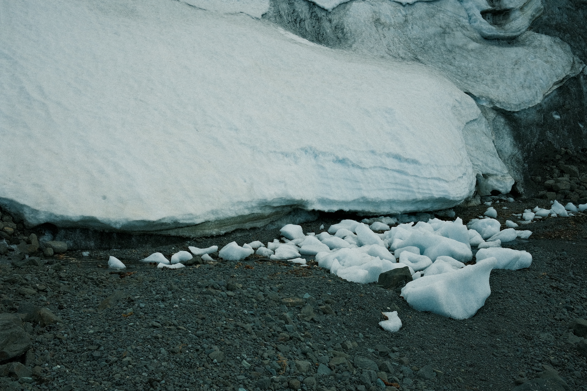
:::

::: {.project-text}
[Isla Rey Jorge, Antártica · Museo MAC Parque Forestal. Santiago, Chile]{.project-location}

## Utopías y distopías de la modernidad (2022–2023)

[RESIDENCIA Y PIEZA SONORA + INGRID WILDI MERINO]{.project-subtitle}
[Registros con hidrófono en costa de témpanos. Pieza sonora «Materia infinitamente porosa», reproducida junto a la pieza visual «Antártica, 1973»]{.project-materials}

Artista invitado a participar de la residencia de investigación en la Antártica chilena, en el marco del proyecto _Utopías y distopías de la modernidad_ de la artista chilena Ingrid Wildi Merino.

A partir de los registros realizados durante la residencia compuse la pieza sonora _Materia infinitamente porosa_, que se reprodujo junto a la pieza visual _Antártica, 1973_ en la sala 5 del Museo de Arte Contemporáneo, sede Parque Forestal, entre noviembre de 2023 y enero de 2024. Parte del material fue publicado también como _Auscultación (± 0.05 msnm)_ en el compilado _start ►_ del Núcleo de Artes Sonoras.

[Documentación completa](https://misaa.cc/projects/utopiasydistopias.html)
:::
:::

<!-- ANID 2027 · NUEVO · Extraños(extranjeros(extraños(…))) -->
::: {.project}
::: {.project-image}
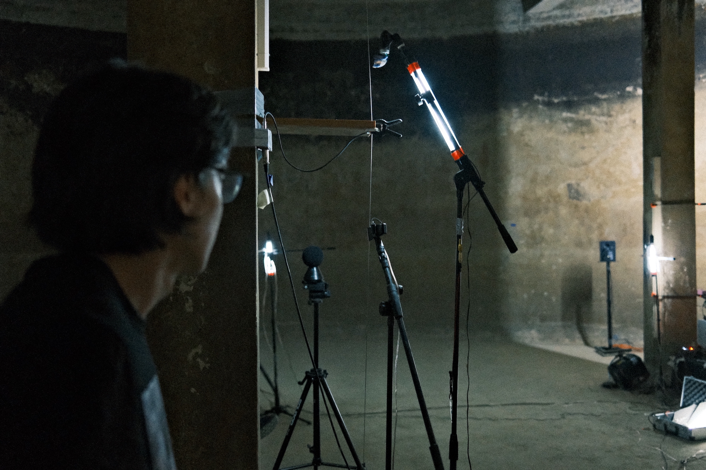
:::

::: {.project-text}
[Festival Espacios Resonantes. Recoleta, Santiago, Chile]{.project-location}

## Extraños(extranjeros(extraños(…))) (2022)

[PERFORMANCE SONORA]{.project-subtitle}
[Performance en estanque subterráneo abandonado. Retroalimentación sonora, mecánica y eléctrica. Streaming: Jota Aldunce]{.project-materials}

Artista invitado a desarrollar una performance en un estanque subterráneo abandonado de la comuna de Recoleta, el 26 de noviembre de 2022.

La performance se basa en la ecología oscura de Timothy Morton, una propuesta coexistencialista que busca evidenciar los ciclos infinitos entre los elementos que constituyen la realidad. Exploré en diversas escalas las implicancias de un sonido generado sobre un pilar del estanque y cómo su vibración se transmite y altera otros entes en su interior. Estas relaciones de simpatía entre objetos generan flujos constantes de retroalimentación, donde no se distingue entre objeto, instrumento y sonido: todo forma parte del mismo sistema ecológico.

[Documentación completa y video](https://misaa.cc/projects/extranosextranjerosextranos.html)
:::
:::

<!-- ANID 2027 · NUEVO · revuelta -->
::: {.project .project-right}
::: {.project-image}
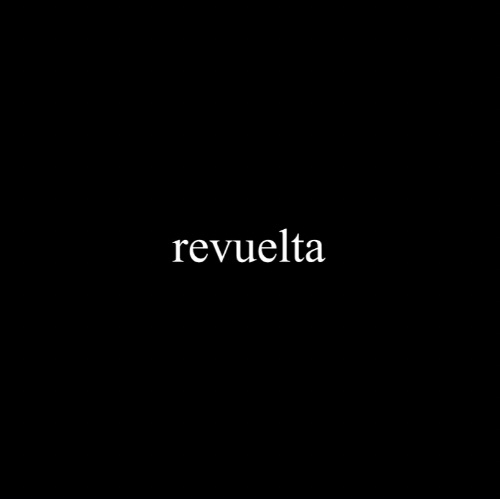
:::

::: {.project-text}
[XXI Festival Internacional de la Imagen. Manizales, Colombia]{.project-location}

## revuelta (2022)

[PIEZA AUDIOVISUAL · 12']{.project-subtitle}
[Paisajes sonoros registrados en el metro de Santiago el 18 de octubre de 2019. Material de archivo: Agencia EFE, Radio Bío-Bío. Grabación en Metro Plaza de Armas: Rainer Krause]{.project-materials}

_revuelta_ es un ejercicio documental construido a partir de paisajes sonoros registrados en el metro de Santiago durante el 18 de octubre de 2019, lugar y día en que se radicalizaron las protestas iniciadas por estudiantes secundarios, que en las horas siguientes se propagarían por todo el país.

La versión audiovisual fue exhibida en el XXI Festival Internacional de la Imagen de Manizales (20 de octubre de 2022). El documental sonoro fue publicado originalmente en el álbum _tres reconstituciones y un documental sonoro_ (2021).

[Documentación completa y video](https://misaa.cc/projects/revuelta_imgfest.html)
:::
:::

<!-- ANID 2027 · NUEVO · Encuentro Tsonami 2019 -->
::: {.project}
::: {.project-image}
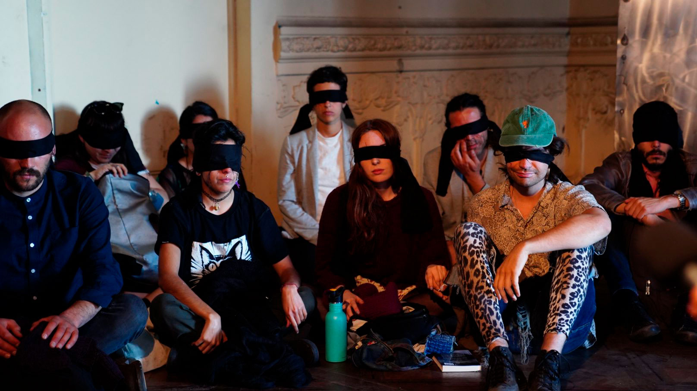
:::

::: {.project-text}
[XIV Festival de Arte Sonoro Tsonami. Valparaíso, Chile]{.project-location}

## Prácticas sonoras en contextos de crisis (2019)

[RESIDENCIA + COLECTIVA 22bits]{.project-subtitle}
[Con Bárbara Molina. Acciones: Cacerolazo permanente, Radio libre para niñas y niños, taller y marcha por el Día de la Discapacidad, ¿Es posible una acústica tecnofeminista?]{.project-materials}

Tras el estallido social, el festival Tsonami 2019 optó por un perfil político vinculado al contexto de crisis. Como Colectiva 22bits, nuestra postura fue salir a la calle a escuchar las voces de personas pertenecientes a categorías no hegemónicas: niñas y niños, mujeres y personas en situación de discapacidad.

Realizamos acciones de llamado a la protesta con tecnologías precarias, una radio libre con registros de niñas y niños dialogando sobre la situación política del país, y un taller de fabricación de instrumentos para la marcha del Día Internacional de la Discapacidad en Viña del Mar, junto a las compañías Otro Cuerpo y Renaciendo y la Fundación Paso a Paso.

[Documentación completa](https://misaa.cc/projects/tsonami2019.html)
:::
:::

<!-- ANID 2027 · NUEVO · Platohedro 2019 -->
::: {.project .project-right}
::: {.project-image}
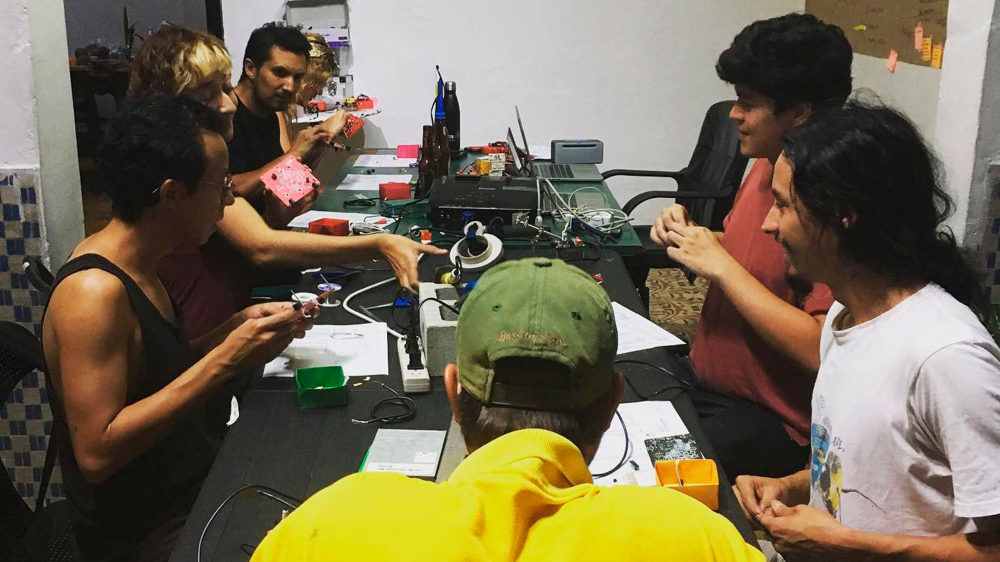
:::

::: {.project-text}
[Platohedro. Medellín, Colombia]{.project-location}

## Sonido tecnofeminista (2019)

[RESIDENCIA + COLECTIVA 22bits]{.project-subtitle}
[Con Bárbara Molina. Programa La Jacquer EsCool. Ciclo de talleres de electrónica y sonido, y concierto colectivo]{.project-materials}

En el marco de una residencia colaborativa de intercambio de conocimiento con Platohedro, la Colectiva 22bits llevó a cabo un ciclo de talleres de electrónica y sonido tecnofeminista, dirigido principalmente a un público identificado con lo femenino.

Se entregaron conocimientos de electrónica básica y principios del sonido, junto con la revisión de referentes que trabajan desde la autogestión musical. El ciclo culminó con un concierto abierto al público, en el que las asistentes utilizaron los artefactos construidos para componer una performance colectiva.

[Documentación completa y video](https://misaa.cc/projects/platohedro.html)
:::
:::

<!-- INICIO PROYECTO DERECHO -->
<!-- INICIO PROYECTO DERECHO -->
<!-- INICIO PROYECTO DERECHO -->

::: {.project .project-right .caption-dark}
::: {.project-image}

:::

::: {.project-text}
[Sala B.A.S.E. Tsonami. Valparaíso, Chile]{.project-location}

## Dispositivas de encarnación (2018)

[INSTALACIÓN + COLECTIVA 22bits + ROSA OYARCE]{.project-subtitle}
[
     Resultado de proceso de residencia. 
]{.project-materials}

El proceso de residencia se inició a partir de una investigación sobre la relación entre las mujeres y la tecnología en Valparaíso, encontrándose en la caleta Portales con Rosa Oyarce y el oficio de las encarnadoras. Es ella quien les enseña cómo se construye el espinel, artefacto que es trabajado por mujeres para la pesca artesanal.

La instalación «Dispositivas de encarnación» nos muestra este oficio y al espinel desde una dimensión sonora y visual, en un ejercicio que no sólo releva la técnica de una tecnología artesanal, sino que también dialoga de cerca con los relatos de vida y las formas de laborar de las mujeres de la caleta. 

Esta obra fue montada también el 2019 en exhibición Marea, (CENTEX, Valparaíso), y en Galería Casa Colorada (Santiago)

[Documentación completa + video](https://misaa.cc/projects/dispositivas.html)
:::
:::

<!-- FIN PROYECTO DERECHO -->
<!-- FIN PROYECTO DERECHO -->
<!-- FIN PROYECTO DERECHO -->

<!-- INICIO PROYECTO -->
<!-- INICIO PROYECTO -->
<!-- INICIO PROYECTO -->

::: {.project}
::: {.project-image}

:::

::: {.project-text}
[Casa 916. Concepción, Chile]{.project-location}

## Espectral (2018)

[PERFORMANCE E INSTALACIÓN + COLECTIVA 22bits]{.project-subtitle}
[Instalación sonora cuadrafónica, resultado de performance en Túnel Punta de Parra junto a AOIR Laboratorio Sonoro. Montada en Casa 916 en Agosto de 2018.]{.project-materials}

"El proyecto Espectral: Escucha de un paisaje intervenido, es una experiencia sonora accesible ofrecida al público, donde un ambiente ajeno es traído al lugar expositivo, generando una experiencia pocas veces vivida en un espacio de exhibición. Los colectivos que desarrollan la obra, llevan y dislocan un ambiente extraño, no en su conformación de este sino a propósito de su abandono. Un túnel de más de 100 años de historia que ha quedado a las inclemencias de la naturaleza, por la salida de nuestro país de las lógicas desarrollistas, dejando un cadáver de un tiempo donde la explotación carbonífera, en las napas marinas, conectaba el litoral con el cordón ferroviario nacional, en dirección inclaudicable a su centro." Extracto de texto de Matías Allende
 
[Documentación completa y video](https://misaa.cc/projects/espectral.html)
:::
:::

<!-- FIN PROYECTO -->
<!-- FIN PROYECTO -->
<!-- FIN PROYECTO -->

<!-- ANID 2027 · NUEVO · Espectral (cortometraje) -->
::: {.project .project-right}
::: {.project-image}
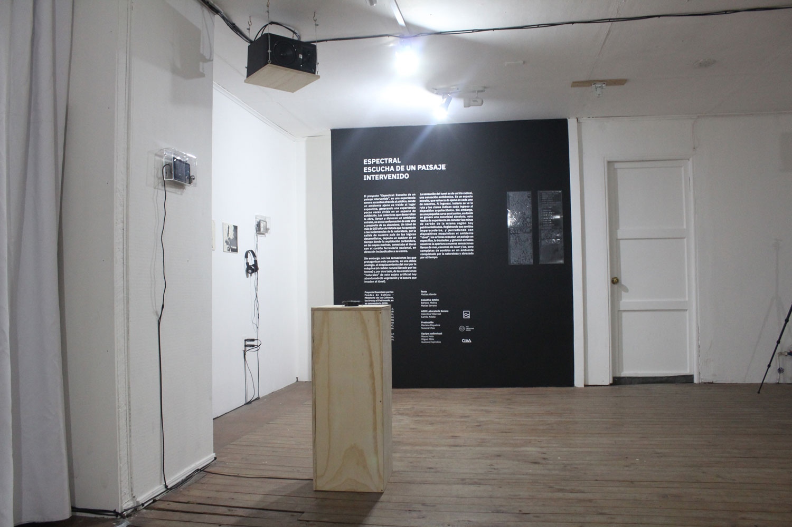
:::

::: {.project-text}
[Strangloscope (Florianópolis) · Cinema Urbana (Brasilia) · ADAF (Atenas)]{.project-location}

## Espectral: Escucha de un paisaje intervenido (2018–2019)

[CORTOMETRAJE EXPERIMENTAL + COLECTIVA 22bits]{.project-subtitle}
[Con Bárbara Molina. Realización audiovisual: Mauro Melo Dussuel. Producción: Colectiva 22bits / Moveshot. Fondart Regional Bío-Bío 2018]{.project-materials}

Cortometraje resultado del proyecto _Espectral_, registrado entre Punta de Parra (Región del Bío-Bío) y Los Queñes (Región del Maule) en julio de 2018. A partir de la performance sonora en el túnel abandonado de Punta de Parra, la pieza traslada la experiencia de escucha de un paisaje intervenido al formato audiovisual.

Fue visionado en la 12ª Strangloscope – Mostra Internacional de Áudio, Vídeo, Filme e Performance Experimental, en el 1º Cinema Urbana Architecture Film Festival de Brasilia y en el 16º Athens Digital Arts Festival. En 2019 se presentó como muestra multicanal en el IV Coloquio Pensar / Crear / Investigar en Músicas y Tecnologías (UDP).

[Ver cortometraje](https://www.youtube.com/watch?v=CFOOE5q3Uj8)
:::
:::

<!-- INICIO PROYECTO DERECHO -->
<!-- INICIO PROYECTO DERECHO -->
<!-- INICIO PROYECTO DERECHO -->

::: {.project .project-right}
::: {.project-image}

:::

::: {.project-text}
[Museo MAC Quinta Normal. Santiago, Chile]{.project-location}

## Ensayo de horizontalidad (2017)

[INSTALACIÓN SONORA]{.project-subtitle}
[8 Baquetas, 8 servomotores, Arduino, plataforma circular de 150cm de diámetro, objetos de desecho, sección de código. 3er lugar con Concurso de Arte y Tecnología en Homenaje a Matilde Pérez
]{.project-materials}

"La propuesta de la obra consiste en resignificar objetos hallados e identitarios de un sector de la ciudad, y a través de las tecnologías digitales, transformarlos en distintas voces que dialogan en torno a un centro, emulando un acto conversacional cotidiano. La carencia de rasgos de cada uno de los "percutores", nos habla de una relación comunicativa en la que las distintas voces se entienden y valoran por su sonido (su relato), más allá de sus características de sexo, edad, religión, clase, género, etc. El algoritmo creado juega dándole a cada baqueta el turno de proponer un ritmo (un tema), y las demás contestan en distintas instancias, o eligen silenciarse, emulando un diálogo cualquiera." — Extracto de texto de sala

[Documentación completa](https://misaa.cc/projects/edh.html)
:::
:::

<!-- FIN PROYECTO DERECHO -->
<!-- FIN PROYECTO DERECHO -->
<!-- FIN PROYECTO DERECHO -->

<!-- ANID 2027 · NUEVO · Percusiones, bits y audiciones -->
::: {.project}
::: {.project-image}
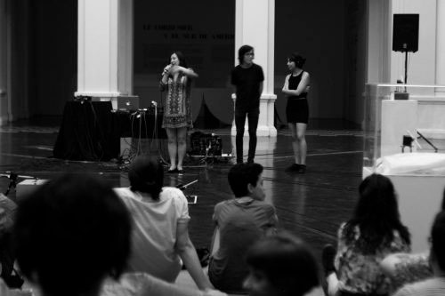
:::

::: {.project-text}
[Hall Museo MAC Parque Forestal. Santiago, Chile]{.project-location}

## Percusiones, bits y audiciones (2017)

[PERFORMANCE SONORA + COLECTIVA 22bits]{.project-subtitle}
[Con Bárbara Molina. Dos secuenciadores Tutupá, 8 objetos del museo intervenidos con micrófonos de contacto, Ableton Live sincronizado vía CV4LIVE. Segundo lugar convocatoria Sonido Específico, Anilla Cultural MAC]{.project-materials}

_Sonido Específico_ es una convocatoria de Anilla Cultural MAC que busca propuestas en torno a las características acústicas del hall del Museo de Arte Contemporáneo, sede Parque Forestal. Como Colectiva 22bits obtuvimos el segundo lugar y presentamos la performance el 18 de enero de 2017.

Dos Tutupá golpeaban ocho objetos encontrados en el museo, amplificados mediante micrófonos de contacto y procesados en tiempo real, esclavizados al tempo de los secuenciadores. La performance transitó desde ritmos minimalistas y complejas polirritmias hasta ambientes cercanos al new age, atravesada por la particular acústica del hall central del MAC.

[Documentación completa y video](https://misaa.cc/projects/sonidoespecifico.html)
:::
:::

<!-- ============================================================
     ANID 2027 · PUBLICACIONES SONORAS — todos los álbumes en una página
     ============================================================ -->
::: {.albums}
## Publicaciones sonoras

[Álbumes individuales publicados bajo el pseudónimo misaa]{.albums-meta}

::: {.album}
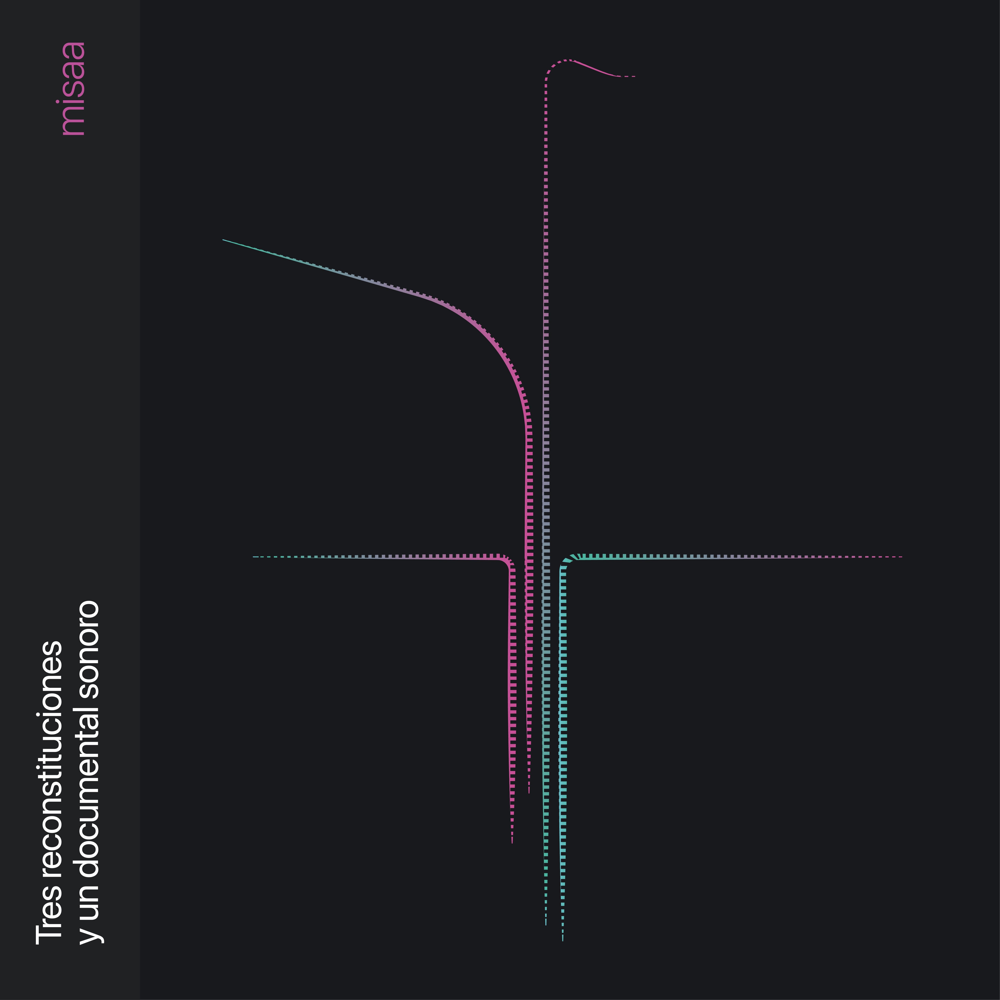

[2021 · Sello Medio Oriente]{.album-meta}

### tres reconstituciones y un documental sonoro

Ejercicio de reconstitución sónica del metro de Santiago de los años noventa y su música ambiental, interrumpido por la revuelta de octubre de 2019: el documental sonoro reúne recortes de cacerolazos, prensa y evacuaciones de estaciones. Cassette, 15 copias. Arte y diseño: Bárbara Molina.

[mediooriente.bandcamp.com](https://mediooriente.bandcamp.com/album/tres-reconstituciones-y-un-documental-sonoro)
:::

::: {.album}
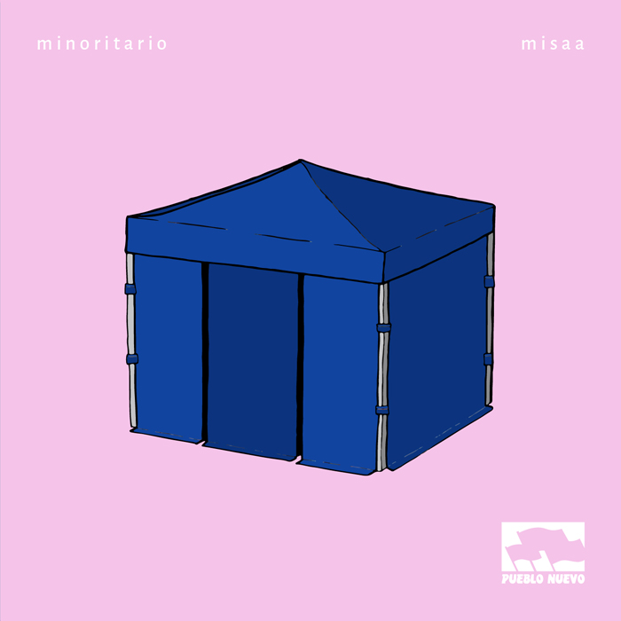

[2020 · Sello Pueblo Nuevo]{.album-meta}

### minoritario

Álbum construido con samples grabados, interpretados y procesados en torno a la idea del devenir minoritario y los flujos que estallaron en Chile desde octubre de 2019. Arte: Mariana Riquelme. Diseño: Bárbara Molina. Reseña: César Fuenzalida.

[pueblonuevo.cl](https://pueblonuevo.cl/catalogo/minoritario/)
:::

::: {.album}
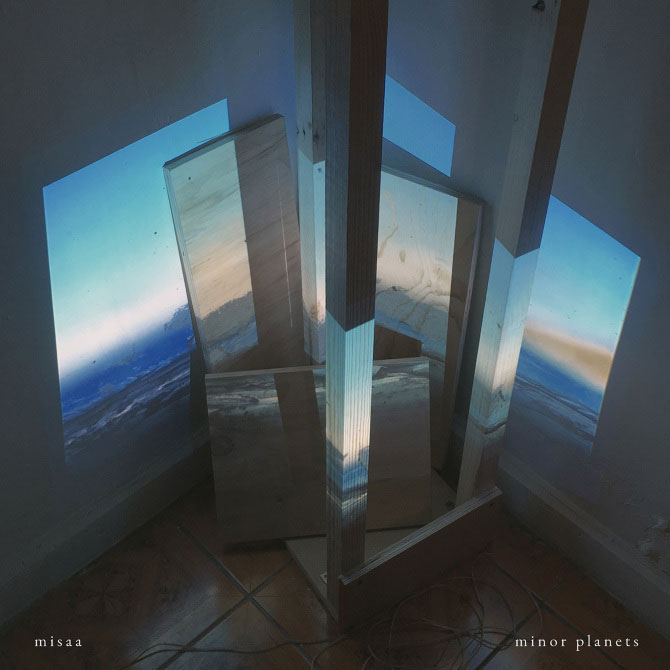

[2019 · Sello Archivo Veintidós]{.album-meta}

### minor planets

Primer álbum solista, producido entre 2014 y 2019. Explora la creación sonora de laboratorio mezclando beats, paisajes sonoros, guitarras y delays, en un proceso personal de varios años. Portada: Pablo Sánchez. Diseño: Bárbara Molina.

[archivoveintidos.bandcamp.com](https://archivoveintidos.bandcamp.com/album/minor-planets)
:::
:::

<!-- ============================================================
     ANID 2027 · PROYECTOS COLECTIVOS — todos en una página
     ============================================================ -->
::: {.collectives}
::: {.collectives-head}
## Proyectos colectivos

[Núcleos, sellos y proyectos interdisciplinares en los que participo]{.albums-meta}
:::

::: {.collective}
[2023 – actualidad · DAV, U. de Chile]{.album-meta}

### Núcleo de Artes Sonoras

Investigación y promoción de las artes sonoras dentro de las artes visuales. Exposición _Tiempo de decaimiento temprano_ (MAC, 2025), conciertos y publicaciones del sello del núcleo.

[nucleoartessonoras.bandcamp.com](https://nucleoartessonoras.bandcamp.com/)
:::

::: {.collective}
[2025 – 2026 · Club Sonoro Deportivo · Fondart]{.album-meta}

### Aproximaciones subacuáticas

Co-director y artista sonoro. Creación e investigación interdisciplinar entre arte sonoro y nado, junto a Fernanda Fábrega y Santiago Corvalán. Concierto _Nada como una metáfora_ (2026).

[clubsonorodeportivo.cl](https://clubsonorodeportivo.cl)
:::

::: {.collective}
[2024 · Organismo Teatro]{.album-meta}

### Árboles ciudadanos

Artista sonoro. Creación e investigación interdisciplinar (electrónica, sonido, teatro y espacio público) en torno a los árboles en entornos urbanos.

[arbolesciudadanos.cl](https://arbolesciudadanos.cl/)
:::

::: {.collective}
[2020 · Depto. de Sonido, U. de Chile]{.album-meta}

### Ruido propio

Núcleo de investigación de memoria e identidad sonora dirigido por la Dra. Carla Badani. Explora el impacto de los fenómenos sonoros en la cultura e historia de las comunidades, con perspectiva de género y decolonial.

[ruidopropio.net](http://ruidopropio.net)
:::

::: {.collective}
[2019 – 2024 · Colectiva 22bits]{.album-meta}

### Archivo Veintidós

Sello de música experimental y arte sonoro del sur global, co-creado y co-dirigido con Bárbara Molina. Distribución gratuita de artistas experimentales de Latinoamérica.

[archivoveintidos.bandcamp.com](https://archivoveintidos.bandcamp.com/)
:::
:::

<!-- ============================================================
     ANID 2027 · PRENSA — extraída de https://misaa.cc/cv.html
     ============================================================ -->
::: {.press}
::: {.press-col}
## Prensa

### Comentarios de obras

[[Crepitar el horizonte](https://aceleracionismo.com/2025/06/21/crepitar-el-horizonte/)]{.press-title}
[Vania Montgomery · Aceleracionismo · jun 2025]{.press-detail}
[<https://aceleracionismo.com/2025/06/21/crepitar-el-horizonte/>]{.press-url}

[[Hacia un museo en estéreo: notas sobre prácticas guerrilleras y polifonías institucionales](https://www.mediales.art/articulos/museo-en-estereo)]{.press-title}
[Victoria Guzmán · Mediales.art · ene 2025]{.press-detail}
[<https://www.mediales.art/articulos/museo-en-estereo>]{.press-url}

[[Cargar una Piedra: Experimento Didáctico y Conversación con Matías Serrano](https://emememe.org/cargar-una-piedra-conversacion-con-matias-serrano/)]{.press-title}
[David Ayala-Alfonso · Múltiples Metonimias Materiales · dic 2024]{.press-detail}
[<https://emememe.org/cargar-una-piedra-conversacion-con-matias-serrano/>]{.press-url}

::: {.press-image}
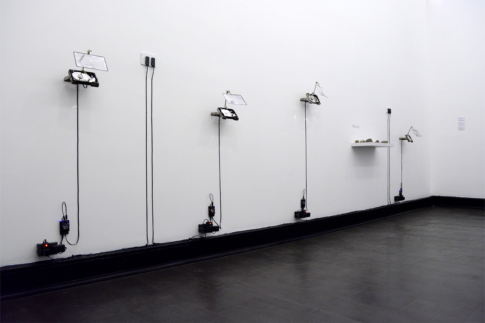
:::

:::

::: {.press-col}
### Entrevistas

[[Exposición "Transistores en tránsito" de Matías Serrano](https://www.youtube.com/watch?v=xAF0xvNSjqU)]{.press-title}
[Valentina Montero · YouTube, PAM Plataforma Arte Medios · jul 2025]{.press-detail}
[<https://www.youtube.com/watch?v=xAF0xvNSjqU>]{.press-url}

[[Matías Serrano: “Escuchar necesariamente tiene que ver con el presente y el aquí y el ahora”](https://web.archive.org/web/20250514151017/https://mim.cl/noticia/matias-serrano-escuchar-necesariamente-tiene-que-ver-con-el-presente-y-el-aqui-y-el-ahora/)]{.press-title}
[Museo Interactivo Mirador · 2024]{.press-detail}
[<https://web.archive.org/web/20250514151017/https://mim.cl/noticia/matias-serrano-escuchar-necesariamente-tiene-que-ver-con-el-presente-y-el-aqui-y-el-ahora/>]{.press-url}

[[Matías Serrano expone “amplificar la duda: exploraciones mediales sobre las sensibilidades extrañas” en Sala Juan Egenau](https://artes.uchile.cl/noticias/220709/matias-serrano-expone-ampliar-la-duda-en-sala-juan-egenau)]{.press-title}
[Macarena Montes · Facultad de Artes, Universidad de Chile · sep 2024]{.press-detail}
[<https://artes.uchile.cl/noticias/220709/matias-serrano-expone-ampliar-la-duda-en-sala-juan-egenau>]{.press-url}

[[Entrevista con Matías Serrano “La memoria contándole a la luz el sonido de la lluvia”](https://www.youtube.com/watch?v=CU5aWG3QbD4)]{.press-title}
[Alexis Llerena · YouTube, PAM Plataforma Arte Medios · abr 2024]{.press-detail}
[<https://www.youtube.com/watch?v=CU5aWG3QbD4>]{.press-url}

[[MATÍAS SERRANO A.K.A. MISAA INTERVIÚ :. Islas Resonantes](https://peruavantgarde.blogspot.com/2021/01/matias-serrano-aka-misaa-interviu-islas.html)]{.press-title}
[Wilder González · Vanguardia Peruana & Sonidos Contemporáneos · ene 2021]{.press-detail}
[<https://peruavantgarde.blogspot.com/2021/01/matias-serrano-aka-misaa-interviu-islas.html>]{.press-url}

[[22bits - Conversas en cuarentena](https://www.youtube.com/watch?v=P6YBM3nIuNE)]{.press-title}
[Valentina Montero · YouTube, PAM Plataforma Arte Medios · oct 2020]{.press-detail}
[<https://www.youtube.com/watch?v=P6YBM3nIuNE>]{.press-url}

[[RUIDO #12](https://www.elruidoeselmensaje.com/ruidos/ruido2020/ruido12/)]{.press-title}
[Franco Falistoco · El RUIDO es el Mensaje · jun 2020]{.press-detail}
[<https://www.elruidoeselmensaje.com/ruidos/ruido2020/ruido12/>]{.press-url}

[[«Tutupá», el invento chileno que desdibuja los límites entre tecnología y arte](https://pousta.com/tutupa-colectivo-22bits-tecno-art/)]{.press-title}
[Marcial Parraguez · Pousta · may 2018]{.press-detail}
[<https://pousta.com/tutupa-colectivo-22bits-tecno-art/>]{.press-url}

:::
:::

::: {.press}
::: {.press-col}
## Prensa

### Notas de prensa

[[Graduados MAM presentan proyecto de exploración artística y deportiva](https://uchile.cl/noticias/238304/graduados-mam-presentan-proyecto-de-exploracion-artistica-y-deportiva)]{.press-title}
[Universidad de Chile · mar 2026]{.press-detail}
[<https://uchile.cl/noticias/238304/graduados-mam-presentan-proyecto-de-exploracion-artistica-y-deportiva>]{.press-url}

[[Explorar el sonido como materia: El Núcleo de Artes Sonoras exhibe “Tiempo de Decaimiento Temprano” en MAC Quinta Normal](https://artes.uchile.cl/noticias/227980/nucleo-de-artes-sonoras-exhibe-tiempo-de-decaimiento-tempran)]{.press-title}
[Facultad de Artes, Universidad de Chile · may 2025]{.press-detail}
[<https://artes.uchile.cl/noticias/227980/nucleo-de-artes-sonoras-exhibe-tiempo-de-decaimiento-tempran>]{.press-url}

[[I Festival Onda Expansiva reúne a más de 30 artistas mediales en el Museo de la Educación Gabriela Mistral](https://www.latercera.com/culto/2024/11/12/i-festival-onda-expansiva-reune-a-mas-de-30-artistas-mediales-en-el-museo-de-la-educacion-gabriela-mistral/)]{.press-title}
[La Tercera · nov 2024]{.press-detail}
[<https://www.latercera.com/culto/2024/11/12/i-festival-onda-expansiva-reune-a-mas-de-30-artistas-mediales-en-el-museo-de-la-educacion-gabriela-mistral/>]{.press-url}

[[MAC UChile celebra veinte años de su sede Quinta Normal inaugurando exhibiciones con más de 50 artistas](https://www.13.cl/c/programas/espacio-13c/mac-uchile-celebra-veinte-anos-de-su-sede-quinta-normal-inaugurando)]{.press-title}
[13C · oct 2024]{.press-detail}
[<https://www.13.cl/c/programas/espacio-13c/mac-uchile-celebra-veinte-anos-de-su-sede-quinta-normal-inaugurando>]{.press-url}

[[Música Impro en el Experimento 18 Azarret La Tehuanita](https://marvin.com.mx/musica-impro-en-el-experimento-18-azarret-la-tehuanita/)]{.press-title}
[Revista Marvin · sep 2024]{.press-detail}
[<https://marvin.com.mx/musica-impro-en-el-experimento-18-azarret-la-tehuanita/>]{.press-url}

[[Académicos DAV participan en ciclo sonoro](https://uchile.cl/noticias/219428/academicos-dav-participan-en-ciclo-sonoro)]{.press-title}
[Universidad de Chile · ago 2024]{.press-detail}
[<https://uchile.cl/noticias/219428/academicos-dav-participan-en-ciclo-sonoro>]{.press-url}

[[Premio MAVI UC LarrainVial Arte joven 2023 recae en egresados del DAV](https://artes.uchile.cl/noticias/207299/premio-mavi-uc-larrainvial-arte-joven-2023-recae-en-egresados-del-dav)]{.press-title}
[Facultad de Artes, Universidad de Chile · jul 2023]{.press-detail}
[<https://artes.uchile.cl/noticias/207299/premio-mavi-uc-larrainvial-arte-joven-2023-recae-en-egresados-del-dav>]{.press-url}

[[Lanzamiento de Núcleo Artes Sonoras incluye conciertos en Las Encinas](https://artes.uchile.cl/noticias/206465/lanzamiento-de-nucleo-artes-sonoras-incluye-conciertos-en-las-encinas)]{.press-title}
[Facultad de Artes, Universidad de Chile · jun 2023]{.press-detail}
[<https://artes.uchile.cl/noticias/206465/lanzamiento-de-nucleo-artes-sonoras-incluye-conciertos-en-las-encinas>]{.press-url}

[[En Atenas se presentarán obras del Núcleo Sonoro del DAV](https://artes.uchile.cl/noticias/202394/en-atenas-se-presentaran-obras-del-nucleo-sonoro-del-dav)]{.press-title}
[Facultad de Artes, Universidad de Chile · ene 2023]{.press-detail}
[<https://artes.uchile.cl/noticias/202394/en-atenas-se-presentaran-obras-del-nucleo-sonoro-del-dav>]{.press-url}

:::

::: {.press-col}
### &nbsp;

[[Con Chile como país invitado comienza el XXI Festival Internacional de la Imagen de Colombia](https://www.cultura.gob.cl/actualidad/con-chile-como-pais-invitado-comienza-el-xxi-festival-internacional-de-la-imagen-de-colombia/)]{.press-title}
[Ministerio de las Culturas, las Artes y el Patrimonio · oct 2022]{.press-detail}
[<https://www.cultura.gob.cl/actualidad/con-chile-como-pais-invitado-comienza-el-xxi-festival-internacional-de-la-imagen-de-colombia/>]{.press-url}

[[Estudiantes del Magister en Artes Mediales transmiten experimentaciones sonoras en Radio Tsonami](https://uchile.cl/noticias/177815/estudiantes-del-mam-transmiten-experimentaciones-sonoras-)]{.press-title}
[Universidad de Chile · jul 2021]{.press-detail}
[<https://uchile.cl/noticias/177815/estudiantes-del-mam-transmiten-experimentaciones-sonoras->]{.press-url}

[[Misaa explora y reconstruye el subsuelo a través del sonido en su nuevo trabajo](https://sunderbeats.com/misaa-explora-y-reconstruye-el-subsuelo-a-traves-del-sonido-en-su-nuevo-trabajo)]{.press-title}
[Sunderbeats · jun 2021]{.press-detail}
[<https://sunderbeats.com/misaa-explora-y-reconstruye-el-subsuelo-a-traves-del-sonido-en-su-nuevo-trabajo>]{.press-url}

[[Ciclo invita a reflexionar sobre identidad y memoria sonora](https://artes.uchile.cl/noticias/170753/ciclo-invita-a-reflexionar-sobre-identidad-y-memoria-sonora)]{.press-title}
[Facultad de Artes, Universidad de Chile · nov 2020]{.press-detail}
[<https://artes.uchile.cl/noticias/170753/ciclo-invita-a-reflexionar-sobre-identidad-y-memoria-sonora>]{.press-url}

[[“Dispositivas de Encarnación” la instalación sonora que recupera labores femeninas de la pesca](https://www.elmostrador.cl/braga/2019/10/14/dispositivas-de-encarnacion-la-instalacion-sonora-que-recupera-labores-femeninas-de-la-pesca/)]{.press-title}
[El Mostrador · oct 2019]{.press-detail}
[<https://www.elmostrador.cl/braga/2019/10/14/dispositivas-de-encarnacion-la-instalacion-sonora-que-recupera-labores-femeninas-de-la-pesca/>]{.press-url}

[[Positivo balance de primeros encuentros regionales de arte y nuevos medios](https://www.cultura.gob.cl/actualidad/positivo-balance-de-primeros-encuentros-regionales-de-arte-y-nuevos-medios/)]{.press-title}
[Ministerio de las Culturas, las Artes y el Patrimonio · oct 2018]{.press-detail}
[<https://www.cultura.gob.cl/actualidad/positivo-balance-de-primeros-encuentros-regionales-de-arte-y-nuevos-medios/>]{.press-url}

[[“Espectral” se adentra en sonoridad del Túnel Punta de Parra](https://www.diarioconcepcion.cl/cultura-y-espectaculos/2018/08/07/espectral-se-adentra-en-sonoridad-del-tunel-punta-de-parra.html)]{.press-title}
[Diario Concepción · ago 2018]{.press-detail}
[<https://www.diarioconcepcion.cl/cultura-y-espectaculos/2018/08/07/espectral-se-adentra-en-sonoridad-del-tunel-punta-de-parra.html>]{.press-url}

[[Espectral: Escucha de un paisaje intervenido, de Colectivo 22bits + AOIR](https://arteymedios.org/?p=583)]{.press-title}
[Plataforma Arte & Medios · jul 2018]{.press-detail}
[<https://arteymedios.org/?p=583>]{.press-url}

:::
:::

<!-- ============================================================
     DOCENCIA + RESIDENCIAS
     extraídos de https://misaa.cc/cv.md
     ============================================================ -->
::: {.cv-spread}
::: {.cv-col .cv-col-left}
## Docencia

[9 cursos · U. de Chile · UDP · UNIACC]{.cv-meta}

[Medios 2]{.cv-item-title}
[Artes Visuales, U. de Chile · 2022 – Actualidad]{.cv-item-detail}

[Electrónica en Soportes Alternativos]{.cv-item-title}
[Artes Visuales, U. de Chile · 2023 – 2025]{.cv-item-detail}

[Electrónica: del dato al objeto]{.cv-item-title}
[Artes Visuales, U. de Chile · 2023 – Actualidad]{.cv-item-detail}

[Aplic. Tecnológicas 1: Electrónica]{.cv-item-title}
[Artes Visuales, UNIACC · 2023 – 2025]{.cv-item-detail}

[Aplic. Tecnológicas 3: Objeto]{.cv-item-title}
[Artes Visuales, UNIACC · 2024 – Actualidad]{.cv-item-detail}

[Laboratorio de Arte y Electrónica]{.cv-item-title}
[Artes Visuales, UDP · 2024 – Actualidad]{.cv-item-detail}

[Taller vertical: Máquinas Electrónicas]{.cv-item-title}
[Diseño, UDP · 2025 – Actualidad]{.cv-item-detail}

[Taller vertical: Máquinas Computacionales]{.cv-item-title}
[Diseño, UDP · 2025 – Actualidad]{.cv-item-detail}

[Pensamiento Computacional]{.cv-item-title}
[Diseño, UDP · 2026 – Actualidad]{.cv-item-detail}
:::

::: {.cv-col .cv-col-right}
## Residencias

[2026 · Territórios Reimaginados: Reclaim Regional]{.cv-item-title}
[Basel, Suiza · DOCK, convocado por MAVI UC]{.cv-item-detail}

[2025 · Radicante, Liquen LAB]{.cv-item-title}
[Estrecho de Magallanes]{.cv-item-detail}

[2024 · Proyecto Error]{.cv-item-title}
[Ciudad de México]{.cv-item-detail}

[2022 · Utopías y distopías de la modernidad]{.cv-item-title}
[Isla Rey Jorge, Antártica · inv. Ingrid Wildi Merino]{.cv-item-detail}

[2021 · Soma RUMOR — II Encuentro Latinoamericano de Arte Sonora]{.cv-item-title}
[Online / Brasil]{.cv-item-detail}

[2019 · Encuentro Tsonami: Prácticas en Contextos de Crisis]{.cv-item-title}
[Valparaíso, Chile]{.cv-item-detail}

[2019 · Platohedro — La Jacquer EsCool]{.cv-item-title}
[Medellín, Colombia]{.cv-item-detail}

[2018 · Tsonami, Sala B.A.S.E.]{.cv-item-title}
[Valparaíso, Chile]{.cv-item-detail}

[2017 · Festival Tsonami]{.cv-item-title}
[Valparaíso, Chile]{.cv-item-detail}
:::
:::

<!-- FIN DOCENCIA + RESIDENCIAS -->

<!-- ============================================================
     ANID 2027 · CV CONDENSADO — generado desde misaa.cc/cv.md
     (sin docencia, residencias ni prensa). Versión completa: https://misaa.cc/cv.html
     ============================================================ -->
::: {.cvfull}
::: {.cvf-col}
## curriculum vitae {.cvf-title}

[Versión condensada, sin docencia, residencias ni prensa (ver secciones anteriores). CV completo con enlaces y registros en [misaa.cc/cv.html](https://misaa.cc/cv.html)]{.cvf-meta}

#### Formación {.cvf-h2}

[2026–]{.cvf-y} Doctorado en Artes y Humanidades. Instituto de Estudios Avanzados. Universidad de Santiago de Chile

[2021–2024]{.cvf-y} Magíster en Artes Mediales. Facultad de Artes. Universidad de Chile.

[2011–2016]{.cvf-y} Licenciado en Artes mención Sonido. Facultad de Artes. Universidad de Chile

[2019–2020]{.cvf-y} Tutoría de Electrónica para Nuevos Medios y Arte Sonoro. Beca Chile Crea. Profesor José Luis Cárdenas

#### Obras y proyectos {.cvf-h2}

##### Participación en exposiciones {.cvf-h3}

[2026]{.cvf-y} *devuélveme a nuestro lado del océano*. Parte de exposición "FFAST", curada por Paola Nava. NIDO Lucía [↗](https://www.instagram.com/p/DduYNoMgGth/){.cvf-link}

[2026]{.cvf-y} *we*. Parte de exposición "Signa", curada por André Strahinja Bousquet. Facultad de Artes, UNIACC [↗](https://www.instagram.com/p/DerseiCm1w4/){.cvf-link}

[2026]{.cvf-y} *Llluvia Metropolitana*. Proyecto expositivo de sitio específico junto a Rainer Krause. Texto por Catalina Montero. Galería Metropolitana \[Santiago, Chile\] [↗](https://galeriametropolitana.org/expos/llluvia-metropolitana-de-matias-serrano-rainer-krause/){.cvf-link}

[2025]{.cvf-y} *La memoria contándole a la luz el sonido de la lluvia.* Parte de exposición “Islas de luz flotan sobre el pasto”, curada por Paola Nava. Galería Cripta \[Santiago, Chile\] [↗](https://aceleracionismo.com/2025/12/22/islas-de-luz-flotan-sobre-el-pasto/){.cvf-link}

[2025]{.cvf-y} *oí 1, oí 2, oí 3*. Instalaciones. Parte de exposición “Cuando todas las palabras sean borradas” junto Almendra Díaz, Galería de Artes Visuales UNIACC \[Santiago, Chile\] [↗](https://www.instagram.com/p/DOCQUSEkawV/){.cvf-link}

[2025]{.cvf-y} *Hablar con extraños*. Instalación sonora adaptada desde *Amplificar la duda*. Curatoría por Vicente Domínguez. Galería Micromedios, Facultad de Arquitectura y Urbanismo, Universidad de Chile \[Santiago, Chile\] [↗](https://translab.uchilefau.cl/hablar-con-extranos/){.cvf-link}

[2025]{.cvf-y} *Un trazo en el oído*. Instalación sonora en exposición colectiva del Núcleo de Artes Sonoras: Tiempo de decaimiento temprano. MAC de Quinta Normal \[Santiago, Chile\] [↗](https://mac.uchile.cl/wp-content/uploads/2025/04/NAS.pdf){.cvf-link}

[2025]{.cvf-y} *Transistores en tránsito*. Instalación sonora en exposición colectiva del Núcleo de Artes Sonoras: Tiempo de decaimiento temprano. MAC de Quinta Normal \[Santiago, Chile\] [↗](https://mac.uchile.cl/wp-content/uploads/2025/04/NAS.pdf){.cvf-link}

[2024]{.cvf-y} *Amplificar la duda*. Instalación sonora en exposición colectiva. Encuentro VOLCÁN: Manifestaciones de la cultura digital. Invernadero Museo Interactivo Mirador \[Santiago, Chile\] [↗](https://mim.cl/noticia/matias-serrano-escuchar-necesariamente-tiene-que-ver-con-el-presente-y-el-aqui-y-el-ahora/){.cvf-link}
:::

::: {.cvf-col}
[2024]{.cvf-y} *Museo en estéreo*. Instalación sonora de creación colectiva. Proyecto creado en conjunto a María Ignacia Valdebenito y Educa MAC. Sala de interacción MAC Quinta Normal \[Santiago, Chile\] [↗](https://mac.uchile.cl/wp-content/uploads/2024/10/educamac_hojamac.pdf){.cvf-link}

[2024]{.cvf-y} *Lenguaje y comunicación*. Instalación sonora en exposición colectiva. Exposición Balmaceda Visual: Bordes Fluidos. MAC Quinta Normal \[Santiago, Chile\] [↗](https://mac.uchile.cl/wp-content/uploads/2024/10/Balmaceda-HMAC-corregida.pdf){.cvf-link}

[2024]{.cvf-y} *Amplificar la duda*. Instalación sonora en exposición individual. Sala Juan Egenau. Departamento de Artes Visuales, Universidad de Chile \[Santiago, Chile\] [↗](https://artes.uchile.cl/noticias/220709/matias-serrano-expone-ampliar-la-duda-en-sala-juan-egenau){.cvf-link}

[2023]{.cvf-y} *La memoria contándole a la luz el sonido de la lluvia*. Instalación sonora en exposición colectiva. Premio del público en XVI Premio Arte Joven MAVI-UC \[Santiago, Chile\] [↗](https://mavi.uc.cl/wp-content/uploads/2024/03/CatalogoPAJ_2023_Low.pdf){.cvf-link}

[2019]{.cvf-y} *Dispositivas de encarnación*. Instalación sonora en exposición individual (Colectiva 22bits + Rosa Oyarce). Galería Casa Colorada \[Santiago, Chile\] [↗](https://www.santiagocultura.cl/events/dispositivas-de-encarnacion-en-galeria-casa-colorada/){.cvf-link}

[2019]{.cvf-y} *Dispositivas de encarnación*. Instalación sonora en exposición colectiva (Colectiva 22bits + Rosa Oyarce). Centro de extensión CENTEX \[Valparaíso, Chile\] [↗](https://issuu.com/centex/docs/catalogo_marea_digital){.cvf-link}

[2018]{.cvf-y} *Espectral: Escucha de un paisaje intervenido*. Instalación sonora en exposición individual (Colectiva 22bits + AOIR Laboratorio Sonoro). Casa 916 \[Concepción, Chile\] [↗](https://www.diarioconcepcion.cl/cultura-y-espectaculos/2018/08/07/espectral-se-adentra-en-sonoridad-del-tunel-punta-de-parra.html){.cvf-link}

[2017]{.cvf-y} *Ensayo de horizontalidad*. Instalación sonora en exposición colectiva (Colectivo 22bits). 6° Concurso de Artes y Tecnologías Digitales en Homenaje a Matilde Pérez. 3er lugar en categoría estudiantes. MAC Quinta Normal \[Santiago, Chile\] [↗](http://misaa.cc/projects/edh.html){.cvf-link}

##### Conciertos, intervenciones y performances {.cvf-h3}

[2026]{.cvf-y} Concierto "Repertorio y negociación". Curso Improvisación Doctorado en Artes y Humanidades. IDEA-USACH. [↗](https://www.youtube.com/watch?v=V07hX_IAGMM){.cvf-link}

[2026]{.cvf-y} Concierto cierre exposición Llluvia Metropolitana + aya yay. Galería Metropolitana.

[2024]{.cvf-y} Líneas de fuerza (+ visuales por @sutilmetal). Museo de la Educación Gabriela Mistral, Festival Onda Expansiva. [↗](https://www.latercera.com/culto/2024/11/12/i-festival-onda-expansiva-reune-a-mas-de-30-artistas-mediales-en-el-museo-de-la-educacion-gabriela-mistral/){.cvf-link}

[2024]{.cvf-y} Lo incompleto (+ visuales por @sutilmetal). Sala Agustín Siré - Núcleo de Artes Sonoras/Foro de las artes 2024 \[Santiago, Chile\] [↗](https://uchile.cl/agenda/220785/10-foro-de-las-artes-concierto-nucleo-artes-sonoras){.cvf-link}

[2024]{.cvf-y} Intervención en Azarret. Restaurant La Tehuanita. \[Ciudad de México\] [↗](https://marvin.com.mx/musica-impro-en-el-experimento-18-azarret-la-tehuanita/){.cvf-link}

[2024]{.cvf-y} nometrónomo (+ Rainer Krause). Museo del Sonido. Núcleo de Artes Sonoras/Ciclo ECOS Canal Alpha Colectivo \[Santiago, Chile\] [↗](https://artes.uchile.cl/noticias/219428/academicos-dav-participan-en-ciclo-sonoro){.cvf-link}

[2024]{.cvf-y} Campos eléctricos afiebrados. Podcast sesiones.para.espectrales. Anilla MAC \[Online, Chile\] [↗](https://www.youtube.com/watch?v=lgXexOipaPY){.cvf-link}

[2024]{.cvf-y} Concierto “Un angelito pasó” + Angie Saiz. Cierre de muestra “Acá, lejos” Departamento Jota \[Santiago, Chile\]

[2023]{.cvf-y} Viento Subantártico. Concierto de lanzamiento Núcleo de Artes Sonoras. Auditorio Departamento de Artes Visuales \[Santiago, Chile\] [↗](https://artes.uchile.cl/noticias/206465/lanzamiento-de-nucleo-artes-sonoras-incluye-conciertos-en-las-encinas){.cvf-link}

[2023]{.cvf-y} / i \ 5. Encuentro icónico. Centro ICONE \[Recoleta, Chile\]

[2023]{.cvf-y} interocepción. Ciclo de prácticas sonoras “Quizás no sea necesario #1” en Espacio AMAZA \[Santiago, Chile\] [↗](http://archivoveintidos.org/articulos/quizasnoseanecesario1.html){.cvf-link}

[2023]{.cvf-y} / i \ 4. Proyectazo audiovisual. MAC Quinta Normal. \[Santiago, Chile\] [↗](https://mac.uchile.cl/mac-cierra-su-temporada-2022-con-proyeccion-y-concierto-en-su-sede-de-quinta-normal/){.cvf-link}
:::

::: {.cvf-col}
[2023]{.cvf-y} / i \ 3. Ciclo Canal Alpha v1. \[Santiago, Chile\] [↗](https://www.instagram.com/p/CnhdfXxOIhx/){.cvf-link}

[2022]{.cvf-y} Extraños(extranjeros(extraños(…))). Festival espacios resonantes. \[Recoleta, Chile\] [↗](http://misaa.cc/projects/extranosextranjerosextranos.html){.cvf-link}

[2022]{.cvf-y} / i \ 2. Seminario de tokatas en Auditorio Departamento de Artes Visuales, U. de Chile. \[Santiago, Chile\] [↗](https://posternurarecords.cl/seminariotokatas2022/){.cvf-link}

[2020]{.cvf-y} Invernadero (como Colectiva 22bits). Desconciertos en cuarentena. Performance Online para Plataforma Arte & Medios. \[Online, Chile\] [↗](https://www.youtube.com/watch?v=Wx7c9HiZk2M){.cvf-link}

[2020]{.cvf-y} Performance Sonora (como Colectiva 22bits). Sonido Único. Galería La Curtiembre, Persa Victor Manuel \[Santiago, Chile\] [↗](http://www.sofiabalbontin.com/?project=sonido-unico){.cvf-link}

[2019]{.cvf-y} Performance sonora (como Colectiva 22bits). Conexión Suiche en La Pascasia \[Medellín, Colombia\] [↗](http://www.sofiabalbontin.com/?project=sonido-unico){.cvf-link}

[2017]{.cvf-y} Percusiones, bits y audiciones (como Colectiva 22bits). Convocatoria Sonido Específico - Anilla Cultural MAC \[Santiago, Chile\] [↗](https://www.youtube.com/watch?v=RQ8Tu6p6V1Y){.cvf-link}

##### Piezas acusmáticas y audiovisuales presentadas {.cvf-h3}

[2025]{.cvf-y} Lenguaje y comunicación + room tone waiting room. @Exposición “Departamento Casa” curada por Marineves Nieto y Sergio Santana @Departamento Jota \[Santiago, Chile\] [↗](https://www.instagram.com/p/DNzKuBOWqw5/){.cvf-link}

[2025]{.cvf-y} Lenguaje y comunicación. @Exposición “Tercer espacio 2025”, Centro Cultural de Osorno \[Osorno, Chile\] [↗](https://www.youtube.com/watch?v=IxG0zl8ez8Y){.cvf-link}

[2025]{.cvf-y} Para oír a la orilla del mar (en colaboración con Sandra Ulloa) @KYMA (Aidipsos, Grecia) [↗](https://nucleoartessonoras.bandcamp.com/album/-){.cvf-link}

[2024]{.cvf-y} Esto (no) es ciencia esto es ruido @Campamento expandido Casa Palacio (Santiago, Chile)

[2024]{.cvf-y} Can you remember the last rain? @The Sound of Anthropocene (Part 6) curada por Wilfred Agricola de cologne (Online. Alemania) [↗](https://cinema.nmartproject.net/hyper-h-03/){.cvf-link}

[2024]{.cvf-y} Campos eléctricos afiebrados. @Podcast sesiones·para·espectrales_00 Anilla MAC \[Santiago, Chile\] [↗](https://www.youtube.com/watch?v=lgXexOipaPY){.cvf-link}

[2023]{.cvf-y} Materia Infinitamente Porosa @Utopías y Distopías de la modernidad. Expo de artista Ingrid Wildi Merino en MAC Parque Forestal (Santiago, Chile) [↗](https://mac.uchile.cl/wp-content/uploads/2023/10/HOJA-MAC-UTOPIAS-Y-DISTOPIAS-1.pdf){.cvf-link}

[2023]{.cvf-y} Asintonía (en colaboración con Lucas Soffia y Mónica Bate) @Una sombra persistante. Auditorio DAV Las Encinas, U. de Chile (Santiago, Chile) [↗](https://artes.uchile.cl/agenda/208609/concierto-acusmatico-una-sombra-persistente-del-nucleo-artes-sonoras){.cvf-link}

[2023]{.cvf-y} Esto (no) es ciencia esto es ruido @Irida Theatre (Atenas, Grecia) [↗](https://artes.uchile.cl/noticias/202394/en-atenas-se-presentaran-obras-del-nucleo-sonoro-del-dav){.cvf-link}

[2022]{.cvf-y} revuelta @XXI Festival Internacional de la Imagen (Manizales, Colombia) [↗](https://festivaldelaimagen.com/wp-content/uploads/2024/02/Cata%CC%81logo_2022.pdf){.cvf-link}

[2021]{.cvf-y} revuelta. Transmisión de proyectos de arte sonoro MAM prof. Rainer Krause @Radio Tsonami (Online) [↗](https://uchile.cl/noticias/177815/estudiantes-del-mam-transmiten-experimentaciones-sonoras-){.cvf-link}

[2020]{.cvf-y} coralina @Muestra Taller Laboratorio Mujeres al borde del ruido (Online. Bogotá, Colombia) [↗](https://www.youtube.com/watch?v=4NPOEp-sG_Q&t=3496s){.cvf-link}

[2020]{.cvf-y} Invernadero @Desconciertos en cuarentena - Plataforma Arte & Medios (Online, Chile) [↗](https://www.youtube.com/watch?v=Wx7c9HiZk2M){.cvf-link}

[2020]{.cvf-y} Catal Huyuk @Porno Espectral 3 - MAC Quinta Normal (Santiago, Chile) [↗](https://residencial.bandcamp.com/album/porno-espectral-3){.cvf-link}
:::

:::

::: {.cvfull}
::: {.cvf-col}
[2018–2019]{.cvf-y} Espectral: Escucha de un paisaje intervenido. Cortometraje resultado proyecto Fondart regional Bío-Bío 2018. Visionado en: 12ª Strangloscope – Mostra Internacional de Áudio, Vídeo, Filme e Performance Experimental | 1º Cinema Urbana Architecture Film Festival Brasilia | 16º \*/ Athens Digital Arts Festival Video Art) [↗](https://www.cultura.sc.gov.br/noticias/1416-noticias-cinema-cic/22069-cic-sedia-12-edicao-da-strangloscope-mostra-internacional-de-audio-video-filme-e-performance-experimental#dia-13-de-setembro-sexta-feira){.cvf-link}

##### Publicaciones sonoras {.cvf-h3}

[2026]{.cvf-y} Nada como una metáfora / Registro concierto creado por Club Sonoro Deportivo. (Sello Archivo Veintidós) [↗](https://archivoveintidos.bandcamp.com/album/nada-como-una-met-fora){.cvf-link}

[2024]{.cvf-y} Asintonía / Pieza sonora en colaboración con Lucas Soffia y Mónica Bate / Una sombra persistente (Sello Núcleo de Artes Sonoras). [↗](https://nucleoartessonoras.bandcamp.com/){.cvf-link}

[2024]{.cvf-y} milimetrópolis, detalle \[1\], remix / Remezcla de obra de Rainer Krause / milimetrópolis: intervención (Sello Núcleo de Artes Sonoras) [↗](https://nucleoartessonoras.bandcamp.com/album/milimetr-polis-intervenci-n){.cvf-link}

[2023]{.cvf-y} Auscultación (± 0.05 msnm) / Pieza sonora para compilado / start ► (Sello Núcleo de Artes Sonoras) [↗](https://nucleoartessonoras.bandcamp.com/album/start){.cvf-link}

[2021]{.cvf-y} tres reconstituciones y un documental sonoro / Álbum individual (Sello Medio Oriente) [↗](https://mediooriente.bandcamp.com/album/tres-reconstituciones-y-un-documental-sonoro){.cvf-link}

[2020]{.cvf-y} minoritario / Álbum individual (Sello Pueblo Nuevo) [↗](https://pueblonuevo.cl/catalogo/minoritario/){.cvf-link}

[2020]{.cvf-y} el pulso que nos llama / Pieza sonora mostrada en festival Pumpumyachkan - Asimtria 15 (Ayacucho, Perú) [↗](https://www.youtube.com/watch?v=Nep-yttRVzg){.cvf-link}

[2019]{.cvf-y} A las cacerolas / Álbum publicado como Colectiva 22bits/Calles de Santiago (Sello Archivo Veintidós) [↗](https://archivoveintidos.bandcamp.com/album/a-las-cacerolas){.cvf-link}

[2019]{.cvf-y} closer objects, they appear mirror / Pieza sonora para compilado / Sumami (Archivo Veintidós) [↗](https://archivoveintidos.bandcamp.com/album/sumami){.cvf-link}

[2019]{.cvf-y} minor planets / Álbum individual (Sello Archivo Veintidós) [↗](https://archivoveintidos.bandcamp.com/album/minor-planets){.cvf-link}

[2019]{.cvf-y} intervención #3 / Registro de intervención sonora + Colectiva 22bits + Hugo Leonello / Exploraciones Sonoras (Sello Archivo Veintidós) [↗](https://archivoveintidos.bandcamp.com/album/exploraciones-sonoras){.cvf-link}

##### Textos {.cvf-h3}

[2026]{.cvf-y} *Todas las piedras que he recogido*. Texto de sala para exposición de Javiera Clavería en Casona Lagos Lira. Santiago, Chile. [↗](https://misaa.cc/docs/todaslaspiedras.pdf){.cvf-link}

[2026]{.cvf-y} *Los gestos y el conocimiento turbulento*. Texto para la publicación *Onomatopeias* del proyecto Aproximaciones subacuáticas. Club Sonoro Deportivo. Santiago, Chile. [↗](https://misaa.cc/docs/gestos-conocimiento-turbulento.pdf){.cvf-link}

[2024]{.cvf-y} *Amplificar la duda: Escuchando a las sensibilidades extrañas*. ((en))clave sonora #4 SONEC Sonoteca/Écfrasis ediciones. Editado por Sebastián Valenzuela-Valdivia, Noelia Muñoz Galindo, Miguel Hernández Aguirre. p. 25-37. [↗](https://misaa.cc/docs/enclave_sonora_Vol_4_compressed-extract.pdf){.cvf-link}

[2023]{.cvf-y} *Amplificar la duda: exploraciones mediales sobre las sensibilidades extrañas.* Santiago, Chile: Universidad de Chile - Facultad de Artes. [↗](https://repositorio.uchile.cl/handle/2250/198291){.cvf-link}

[2022]{.cvf-y} *La nostalgia del ruido*. VIRAL. Editado por El Rayo Verde p. 192-197. 2022-A-4575. Santiago, Chile. [↗](https://misaa.cc/docs/Texto%20Viral.pdf){.cvf-link}

[2022]{.cvf-y} Bárbara Molina y Matías Serrano, *Dispositivas de Encarnación*. Memoria BASE 2018- 2021 Tsonami. Editado por Tsonami. p. 32-37. ISBN 978-956-09669-1-9 [↗](https://misaa.cc/docs/Memoria_Tsonami2022web-extract.pdf){.cvf-link}

[2021]{.cvf-y} Bárbara Molina y Matías Serrano, *¿Es posible una acústica feminista?*. Encuentro Sonoro Tsonami 2019 (Practicas sonoras en contextos de crisis). Editado por Tsonami. p. 32-28. ISBN 978-956-09669-0-2 [↗](https://misaa.cc/docs/esposibleunaacusticafeminista-2019.pdf){.cvf-link}
:::

::: {.cvf-col}
[2018]{.cvf-y} Bárbara Molina y Matías Serrano, *Ningún ruido es inocente*. Intersecta (Seminario de Artes Mediales), editado por Daniel Cruz. Ediciones departamento de Artes Visuales. 2018. p. 143-147. ISBN 978-956-19-1099-7

##### Becas, premios y fondos obtenidos {.cvf-h3}

[2026]{.cvf-y} Beca completa (arancel y mantención). Doctorado en Artes y Humanidades. Universidad de Santiago de Chile

[2023]{.cvf-y} Premio del público. XVI Premio Arte Joven MAVI-UC. Obra “La memoria contándole a la luz el sonido de la lluvia”

[2019]{.cvf-y} Beca Chile Crea / Fondos Ministerio de las Culturas Chile. Proyecto “Tutoría de electrónica para los nuevos medios y el arte sonoro” con el profesor José Luis Cárdenas

[2018]{.cvf-y} Fondo de creación y producción / Fondart regional Bío-Bío. Ministerio de las Culturas Chile. Proyecto “Espectral: Escucha de un paisaje intervenido”.

[2017]{.cvf-y} 3er lugar categoría estudiantes. 6° Concurso Matilde Pérez. Obra “Ensayo de Horizontalidad”

##### Charlas, seminarios y presentaciones en coloquios {.cvf-h3}

[2025]{.cvf-y} *Prácticas sonoras más allá de la correlación*. 1er Simposio Arte Sonoro Latinoamericano. Universidad Autónoma Metropolitana Unidad Lerma, Ciudad de México

[2025]{.cvf-y} *La materialización de lo virtual*. Participación en coloquio sobre arte y pandemia moderado por Tatiana Julio, Plataforma Arte & Medios. Publicación realizada en el marco de la 17 Bienal de Artes Mediales. Virtual. [↗](https://www.youtube.com/watch?v=_-ZQS7ogFeI){.cvf-link}

[2025]{.cvf-y} *Tiempo y materia sónica: hacia una definición no-negativa de Arte Sonoro*. Coloquio Posthumanamente hablando, organizado por Plataforma Arte & Medios. MAC Parque Forestal [↗](https://www.youtube.com/watch?v=pMOZ7MKvgbQ){.cvf-link}

[2025]{.cvf-y} *Diseño de máquinas para arte electrónico*. Discusiones Contemporáneas del Diseño, organizado por Diseño UDP. Palacio Pereira [↗](https://www.notion.so/CV-12ba3271bffd800bbc1cf7b18d84a309?pvs=21){.cvf-link}

[2024]{.cvf-y} *Ciclo de diálogos formativos: Prácticas artísticas en espacios de exhibición no formal.* Espacio Ksa8. Invitado por Corporación Cultural USACH [↗](https://www.instagram.com/p/DCm4cZ_zJdL/?img_index=4){.cvf-link}

[2024]{.cvf-y} *La exploración de la escucha, a través de la experimentación tecnológica, sonora y transdisciplinar*. Aula Expandida. Escuela de Arte UDP. Santiago, Chile. [↗](https://www.instagram.com/p/C6Mf0QpORIw/){.cvf-link}

[2022]{.cvf-y} *Poéticas de la erosión, o por qué nunca puedes estar seguro de lo que eres*. Cátedra DAC - “Proyectos desarrollados en intersección del Diseño, el Arte y la Ciencia”. Universidad Jorge Tadeo Lozano. Online [↗](https://youtu.be/t1VY9S8nxf4?list=PL28rHu3sewhTDGQesX5vy2A37dZ3XPsHV&t=2308){.cvf-link}

[2019]{.cvf-y} *Espectral, escucha de un paisaje intervenido. Muestra de cortometraje experimental multicanal*. Bárbara Molina, Matías Serrano Acevedo y Mauro Melo Dussuel (Colectivo 22 bits). IV Coloquio Pensar / Crear / Investigar en Músicas y Tecnologías. Facultad de Psicología UDP. Santiago, Chile. [↗](https://pueblonuevo.cl/eventos/iv-coloquio-pensar-crear-investigar/){.cvf-link}

[2018]{.cvf-y} *Schaffer abrió una caja: Experiencias creativas desde el objeto sonoro*. Bárbara Molina y Matías Serrano Acevedo (Colectiva 22bits). III Coloquio Pensar / Crear / Investigar en Músicas y Tecnologías. Facultad de Psicología UDP. Santiago, Chile. [↗](https://cear.udp.cl/programacion-tercer-coloquio-pensarcrearinvestigar-en-musicas-y-tecnologias/){.cvf-link}
:::

::: {.cvf-col}
[2017]{.cvf-y} *Diseño y código libre en instrumentos musicales electrónicos*. Bárbara Molina y Matías Serrano. Conferencia XII Encuentro Latinoamericano de Diseño. Buenos Aires, Argentina [↗](https://www.researchgate.net/profile/Danilo_Calvache/publication/340681739_La_metodologia_de_diseno_al_interior_de_los_programas_de_diseno_industrial_colombiano_hacia_el_planteamiento_de_formas_propias_de_hacer_diseno/links/5e98c80ea6fdcca7891ffd43/La-metodologia-de-diseno-al-interior-de-los-programas-de-diseno-industrial-colombiano-hacia-el-planteamiento-de-formas-propias-de-hacer-diseno.pdf){.cvf-link}

##### Otros proyectos {.cvf-h3}

[2023–actualidad]{.cvf-y} Núcleo de Artes Sonoras. Investigación y promoción de las artes sonoras dentro de las Artes Visuales. Departamento de Artes Visuales, U. de Chile [↗](https://nucleoartessonoras.bandcamp.com/){.cvf-link}

[2025–2026]{.cvf-y} Aproximaciones subacuáticas. Proyecto de creación e investigación interdisciplinar (arte sonoro y nado). Proyecto Fondart dirigido por Fernanda Fábrega. [↗](https://clubsonorodeportivo.cl){.cvf-link}

[2024]{.cvf-y} Árboles ciudadanos. Proyecto de creación e investigación interdisciplinar (electrónica, sonido, teatro y espacio público) en torno a los árboles en entornos urbanos. Producido por compañía Organismo Teatro. [↗](https://arbolesciudadanos.cl/){.cvf-link}

[2020]{.cvf-y} Ruido propio. Núcleo de investigación de memoria e identidad sonora dirigido por Dra. Carla Badani. Departamento de Sonido, Universidad de Chile.

[2019–2024]{.cvf-y} Archivo Veintidós. Sello de Música Experimental y Arte Sonoro del sur global co-creado y co-dirigido con Bárbara Molina (Colectiva 22bits)

[2018–2020]{.cvf-y} Casa Oram. Espacio de talleres y actividades en torno a la tecnología y la escucha ubicado en barrio Matta Sur, coordinado en conjunto a Bárbara Molina (Colectiva 22bits)

[2016]{.cvf-y} Tutupá. Proyecto de investigación y creación tecnológica. Convocatoria Becas Santiago Maker Space.

#### Experiencia Laboral {.cvf-h2}

##### Artes Visuales {.cvf-h3}

[2025]{.cvf-y} Cómo armar una máquina en 10 pasos | art. M. Ignacia C. X. Valdebenito G. \[Expo MAC PF\] - Producción técnica

[2024]{.cvf-y} Acá, lejos | art. Angie Saiz \[Expo Departamento Jota\] - Producción técnica

[2024]{.cvf-y} Santuario: Arte contemporáneo en Valdivia | cur. Ignacio Smulewicz \[Expo Palacio Pereira\] - Montaje audiovisual e iluminación

[2024]{.cvf-y} Silencio Amplificado | art. Cecilia Flore Aracena \[Expo MAC PF\] - Producción técnica

[2024]{.cvf-y} Inês Paulino: (auto)retrato de archivo | cur. Andrea Josch \[Expo Palacio Pereira\] - Iluminación

[2023]{.cvf-y} Woven Memory | art. Soledad Muñoz \[Expo Londres 38\] - Producción técnica

[2023]{.cvf-y} La memoria en el cuerpo | art. Janet Toro \[Expo MAC PF\] - Producción técnica

[2023]{.cvf-y} Utopías y distopías de la modernidad | art. Ingrid Wildi Merino \[Expo MAC PF\] - Artista Sonoro invitado

[2023]{.cvf-y} Hidroscopía Loa | art. Claudia González \[Expo MIM\] - Diseño electrónico

[2023]{.cvf-y} Unidad AnillaMAC (2021 - 2023) - Producción de actividades, seminarios y exposiciones
:::

:::

::: {.cvfull}
::: {.cvf-col}
[2022]{.cvf-y} Lo que no fue no será | art. Débora Caro \[Expo GGM\] - Producción técnica

[2022]{.cvf-y} Rauschmittel | art. Rainer Krause \[Expo MAC PF\] - Diseño acústico y producción técnica

[2022]{.cvf-y} En la selva hay mucho por hacer | cur. María Berríos \[Expo MSSA\] - Montaje audiovisual

[2021]{.cvf-y} Vertiente Tonal | art. Gonzalo Cueto \[Expo MSSA\] - Montaje audiovisual

[2021]{.cvf-y} Tregua | art. Angie Saiz \[Expo Galería Metropolitana\] - Producción técnica

[2019]{.cvf-y} Semiconductor \[Expo CNAC/Bienal Artes Mediales\] - Montaje

[2019]{.cvf-y} Zimoun \[Expo MAC QN\] - Montaje/Key Helper

[2019]{.cvf-y} Historia de un destino imposible | art. Mía Makela \[Expo MAC PF\] - Post-producción de sonido

[2019]{.cvf-y} Coral, colectivo, tectónico | art. Constanza Alarcón-Tennen + Yo-Yo Ma \[Intervención GAM\] - Prod. Técnica

[2019]{.cvf-y} Temblor (in)sensible | art. Diego Bernaschina \[CENTEX\] Post-producción de Sonido

[2018]{.cvf-y} Hidroscopía/Loa | art. Claudia González \[Expo MSSA\] - Diseño electrónico y montaje

[2018]{.cvf-y} Haciendo Barrio \[Expo MSSA\] - Montaje audiovisual

[2018]{.cvf-y} Past Disquiet \[Expo MSSA\] - Montaje audiovisual

[2017]{.cvf-y} Club Social y Deportivo Porvenir | art. Diego Santa María \[Expo MAC QN\] - Producción técnica

[2017]{.cvf-y} Unidad de Producción MAC (2016 - 2017) - Producción técnica de actividades y exposiciones

[2017]{.cvf-y} Transparencia Sonora | art. Paz Lira \[Expo MNBA\] - Diseño de sonido

[2017]{.cvf-y} Las Malportadas: Crimen y devoción en el norte de Chile \[Expo Archivo Nacional\] - Montaje

[2016]{.cvf-y} Resistir en lenguas | art. Verónica Troncoso \[Expo MSSA\] - Diseño de sonido y producción técnica

[2016]{.cvf-y} Práctica profesional Anilla Cultural MAC (2016) - Asistencia de producción técnica

[2015]{.cvf-y} Arqueología de la ausencia | art. Verónica Troncoso \[Expo MAC QN\] - Diseño de sonido y montaje

[2015]{.cvf-y} 120 escalones y un café | art. Verónica Troncoso \[Expo PCdV\] - Diseño de sonido y montaje

[2014]{.cvf-y} Huelga de Hambre CEPAL, 1977 \[Expo MMDH\] | Diseño de sonido y montaje

##### Audiovisual {.cvf-h3}

[2022]{.cvf-y} Allanamiento | prod. Camila Rodó \[Largometraje\] - Música Original

[2021]{.cvf-y} Recorrido literario patrimonial de Valdivia \[Cápsulas digitales\] - Diseño de sonido y post-producción de Sonido

[2019]{.cvf-y} Vocería Popular \[Cápsulas digitales\] - Post-producción de Sonido y música original

[2018]{.cvf-y} Amankay | dir. Katherine Torres \[Cortometraje\] - Post-producción de Sonido
:::

::: {.cvf-col}
[2017]{.cvf-y} Soberanía | dir. María Jesús Torres, César Fuenzalida, Carlos Montes de Oca \[Largometraje documental\] - Post-producción de Sonido y Música Original

[2016]{.cvf-y} La Sombra del Canto | dir. Antonio Carrillo \[Largometraje documental\] - Post-producción de Sonido

[2016]{.cvf-y} Vecinos del Volcán | dir. Iván Tziboulka \[Miniserie TVN\] - Post-producción de Sonido

[2016]{.cvf-y} El polvo se nos sube al rostro | dir. Guillermo del Castillo \[Cortometraje\] - Post-producción de sonido y sonido directo

[2015]{.cvf-y} La Bicicleta Temporada 3 | dir. Antonio Carrillo \[Serie Canal 13C\] - Post-producción de sonido y sonido directo

[2015]{.cvf-y} Las Plantas | dir. Roberto Doveris \[Largometraje\] - Post-producción de sonido

[2015]{.cvf-y} Llegar | dir. Camila Ramírez \[Cortometraje\] - Música original, post-producción de sonido y sonido directo

[2015]{.cvf-y} Ojo x ojo | dir. Andrés Abrigo \[Cortometraje\] - Música original, post-producción de sonido y sonido directo

[2014]{.cvf-y} La Bicicleta Temporada 2 | dir. Antonio Carrillo \[Serie Canal 13C\] - Post-producción de sonido y sonido directo

[2014]{.cvf-y} La Ñecla y el Chonchón | dir. Jose Parra \[Cortometraje\] - Post-producción de sonido y sonido directo

[2013]{.cvf-y} La Bicicleta Temporada 1 | dir. Antonio Carrillo \[Serie Canal 13C\] - Post-producción de sonido y sonido directo

##### Producción musical {.cvf-h3}

[2024]{.cvf-y} Ángelo Escobar en Plectrum \[Concierto en vivo\] - Producción y grabación

[2020]{.cvf-y} Cantar | Chinoy \[Álbum\] - Mezcla y masterización disco 2

[2019]{.cvf-y} De Juana | Ángelo Escobar \[Álbum\] - Mezcla y masterización

[2018]{.cvf-y} Losing Memories | Acrobatic \[Álbum\] - Masterización

[2014]{.cvf-y} Acrobatic | Acrobatic \[Álbum\] - Masterización

[2014]{.cvf-y} Canto al programa | Canto Crisol \[Álbum\] - Masterización

[CV completo, actualizado y con enlaces a registros: [misaa.cc/cv.html](https://misaa.cc/cv.html)]{.cvf-meta .cvf-end}
:::

:::

<!-- FIN CV CONDENSADO -->

<!-- ============================================================
     PÁGINA DE CIERRE — contacto y enlaces
     ============================================================ -->
::: {.closing style="background-image: url('./images/pcb-card.jpeg')"}
::: {.closing-content}
## Matías Serrano Acevedo

[web: https://misaa.cc](https://misaa.cc){.closing-link}

[instagram: @misaa.cc](https://instagram.com/misaa.cc){.closing-link}

[github: misaaaaaa](https://github.com/misaaaaaa){.closing-link}

[full cv: misaa.cc/cv.html](https://misaa.cc/cv.html){.closing-link}

[mail: matias.serranoacevedo@gmail.com](mailto:matias.serranoacevedo@gmail.com){.closing-link}
:::

::: {.closing-footer}
Portafolio construido en Markdown + [paged.js](https://pagedjs.org) · Código fuente en [github.com/misaaaaaa/portfolio-anid-2027](https://github.com/misaaaaaa/portfolio-anid-2027)
:::
:::

<!-- FIN PÁGINA DE CIERRE -->